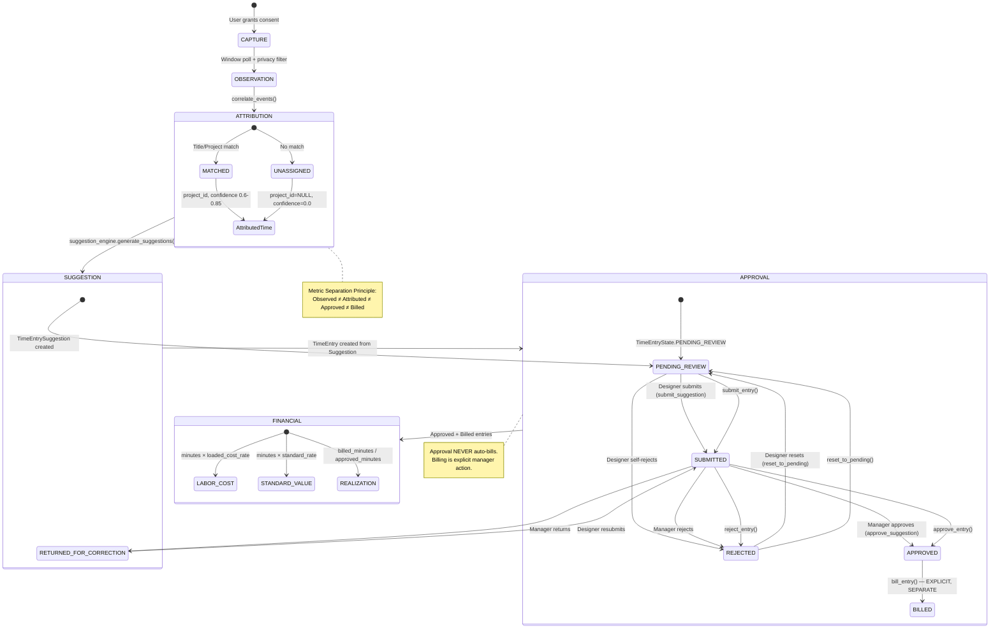
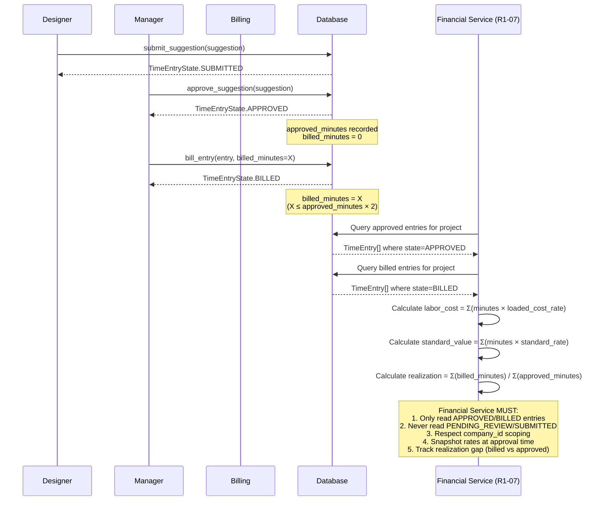

# Architecture Review — BIMSpend R1-06

**Baseline**: `4e83d9b41533423f50c1f8042a2a2ef79445f0a4`
**Audit Branch**: `audit/kilo-nemotron-r1-06-independent-review`

---

## Application Architecture Overview

```
┌─────────────────────────────────────────────────────────────────────────────┐
│                        BIMSpend Desktop Application                          │
├─────────────────────────────────────────────────────────────────────────────┤
│  GUI Layer (Tkinter)                                                        │
│  ┌──────────────┐  ┌────────────────────────────────────────────────────┐   │
│  │  BIMSpendApp │──│  Screen Manager (12 screens)                       │   │
│  │  (shell.py)  │  │  Overview, Projects, Activity, Integrations,       │   │
│  └──────────────┘  │  Timesheet Review, Team, Reports, Estimating,      │   │
│         │          │  Designer Review, Manager Approval                 │   │
│         ▼          └────────────────────────────────────────────────────┘   │
│  ┌────────────────────────────────────────────────────────────────────┐    │
│  │                    Domain Services Layer                            │    │
│  │  ┌──────────┐ ┌──────────┐ ┌──────────┐ ┌──────────┐ ┌────────┐   │    │
│  │  │  Auth    │ │Capture   │ │Correlate │ │ Suggest  │ │ Review │   │    │
│  │  │ (auth.py)│ │(controller)│ │(correlation)│ │(engine)  │ │(review)│   │    │
│  │  └──────────┘ └──────────┘ └──────────┘ └──────────┘ └────────┘   │    │
│  └────────────────────────────────────────────────────────────────────┘    │
│         │          │          │          │          │          │          │
│         ▼          ▼          ▼          ▼          ▼          ▼          │
│  ┌────────────────────────────────────────────────────────────────────┐    │
│  │                    Data Access Layer (Database)                     │    │
│  │  SQLite (WAL mode) — projects, activity_events, attributed_time,   │    │
│  │  time_entries, time_entry_suggestions, suggestion_decisions,       │    │
│  │  revit_sessions, revit_documents, revit_document_mappings,         │    │
│  │  revit_correlation_evidence, companies, sessions, etc.             │    │
│  └────────────────────────────────────────────────────────────────────┘    │
│         │          │          │          │          │          │          │
│         ▼          ▼          ▼          ▼          ▼          ▼          │
│  ┌────────────────────────────────────────────────────────────────────┐    │
│  │                    Adapter / Integration Layer                      │    │
│  │  ┌──────────────┐ ┌──────────────┐ ┌──────────────┐ ┌──────────┐   │    │
│  │  │ ActivityWatch│ │    Miru      │ │    Revit     │ │   IPC    │   │    │
│  │  │ (derived)    │ │ (adapter)    │ │ (connector)  │ │ (pipe)   │   │    │
│  │  └──────────────┘ └──────────────┘ └──────────────┘ └──────────┘   │    │
│  └────────────────────────────────────────────────────────────────────┘    │
└─────────────────────────────────────────────────────────────────────────────┘
```

---

## Module Boundaries & Separation of Concerns

### Layer 1: Capture (`src/bimspend/capture/`)
- **controller.py** — Capture lifecycle, consent, SQLite persistence
- **activitywatch_derived/** — Windows foreground window polling (MPL-2.0)
- **afk_detector.py** — `GetLastInputInfo` system idle detection
- **session_lock.py** — WTSAPI32 session lock/unlock notification
- **heartbeat.py** — Interval management, idempotent event generation
- **revit_connector.py** — Revit API event subscription (stub)
- **revit_ipc.py** — Named pipe communication
- **project_correlation.py** — Document-to-project mapping engine
- **suggestion_engine.py** — Observation → suggestion grouping
- **suggestion_domain.py** — Suggestion lifecycle (submit/approve/reject/split/merge)

**Boundary**: Pure capture → domain conversion. No GUI, no auth (except config).

### Layer 2: Domain Services (`src/bimspend/`)
- **auth.py** — PBKDF2-SHA256, session management, consent
- **correlation.py** — Window-title → project matching (simple heuristic)
- **review.py** — TimeEntry state machine (pending→submitted→approved→billed)
- **dashboard.py** — Aggregated project-hour summaries
- **identity.py** — Actor/SessionContext, fail-closed authorization
- **models.py** — Core dataclasses (Project, ActivityEvent, AttributedTime, TimeEntry, Suggestion)
- **runner.py** — Vertical-slice demo orchestration

**Boundary**: Business logic, no Tkinter, no Windows APIs directly.

### Layer 3: GUI (`src/bimspend/app/`)
- **shell.py** — Main window, sidebar, screen factory, data loading
- **screens/** — 12 screen classes (Overview, Projects, Timeline, Review, Approval, etc.)

**Boundary**: Pure presentation. Delegates to domain services.

### Layer 4: Adapters (`src/bimspend/adapters/`)
- **base.py** — Abstract interfaces (ProjectAdapter, ActivityAdapter, CorrelationAdapter, ReviewAdapter, DashboardAdapter)
- **activitywatch.py** — Reads synthetic JSON fixtures
- **miru.py** — Reads synthetic JSON fixtures

**Boundary**: External system integration. Swappable implementations.

---

## Data Flow: CAPTURE → OBSERVATION → ATTRIBUTION → SUGGESTION → REVIEW → APPROVAL → FINANCIAL

```
1. CAPTURE (controller.py + activitywatch_derived)
   └─ get_current_window() → privacy_filter → ActivityEvent → ingest_event()
   
2. OBSERVATION (activity_events table)
   └─ Raw window events (hashed titles, company-scoped, idempotent)
   
3. ATTRIBUTION (correlation.py)
   └─ correlate_events() → AttributedTime (project_id, confidence, method)
   └─ UNASSIGNED if no match — NO automatic fallback
   
4. SUGGESTION (suggestion_engine.py)
   └─ collect_observations() → filter AFK/locked → group by project
   └─ TimeEntrySuggestion (pending_review, evidence_ids, confidence)
   
5. REVIEW (suggestion_domain.py + review.py)
   ├─ Designer: pending_review → submitted (submit_suggestion)
   ├─ Manager: submitted → approved/rejected (approve/reject_suggestion)
   └─ Billing: approved → billed (bill_entry, explicit, separate)
   
6. APPROVAL (review.py + suggestion_domain.py)
   └─ State machine enforced: PENDING_REVIEW → SUBMITTED → APPROVED → BILLED
   └─ REJECTED → PENDING_REVIEW (reset_to_pending)
   └─ Audit trail: time_entry_audit, suggestion_decisions
   
7. FINANCIAL ELIGIBILITY (dashboard.py + models.py)
   └─ Approved TimeEntry.minutes × Project.loaded_cost_rate = labor_cost
   └─ Approved TimeEntry.minutes × Project.standard_rate = standard_value
   └─ Billed minutes tracked separately (realization gap)
   └─ R1-06: NO financial bridge implemented (deferred to R1-07)
```

---

## Coupling Analysis

### Acceptable Coupling
| From | To | Type | Justification |
|------|-----|------|---------------|
| shell.py | screens/* | Factory | Lazy imports, screen interface |
| shell.py | db, models, auth | Direct | App orchestrates domain |
| controller.py | db, models | Direct | Capture persistence |
| suggestion_engine.py | db, models | Direct | Suggestion generation |
| suggestion_domain.py | db, models, identity | Direct | Domain service |
| review.py | db, models, identity | Direct | Domain service |
| runner.py | all domain | Direct | Demo orchestration |

### Concerning Coupling
| From | To | Issue | Risk |
|------|-----|-------|------|
| shell.py | correlation, review, dashboard | Direct imports in _load_data() | GUI tightly bound to domain init logic |
| controller.py | current_auth (identity) | Module-level auth context | Capture depends on global auth state |
| suggestion_engine.py | db.conn raw SQL | Bypasses Database methods | Tight coupling to schema |
| runner.py | All layers | God orchestration | Not reusable, test-only |

### Circular Dependency Check
**No circular dependencies detected** — Import graph is acyclic:
- adapters/base.py ← (models) → db.py → models.py
- capture/* → db.py, models.py, identity.py
- app/* → db.py, models.py, correlation.py, review.py, dashboard.py, auth.py
- auth.py → db.py, identity.py
- identity.py → db.py (optional)

---

## Technical Debt

| Area | Debt | Impact |
|------|------|--------|
| **shell.py:_load_data()** | 50 lines of fixture seeding, correlation, suggestion creation in GUI class | Violates separation; hard to test; mixes demo data with app init |
| **runner.py** | 197 lines of vertical-slice demo logic | Should be in tests/examples, not production code |
| **controller.py:_persist_event()** | Computes `external_id` inline; title hashing duplicated | Logic belongs in model or helper |
| **suggestion_engine.py:_event_to_observation()** | Raw SQL query on `db.conn` | Bypasses Database abstraction |
| **Database methods** | 8/10 accept `company_id` param but don't enforce in queries | Potential cross-tenant leakage |
| **AFK/lock detectors** | Global system state, not per-session | Incorrect on multi-user Windows |
| **Revit connector** | Python stub with `try/except ImportError` | Not a real integration |

---

## Recommended Architectural Improvements

### P0 — Security & Data Integrity
1. **Move consent enforcement into Database.ingest_event()** — Gate all capture at persistence layer
2. **Add FK constraint on `time_entries.attributed_time_id`** — Prevent orphaned time entries
3. **Enforce company_id in ALL Database queries** — Audit every `list_*`, `get_*` method

### P1 — Core Workflow Reliability
4. **Extract shell._load_data() into a `DataSeeder` service** — Separate demo seeding from app startup
5. **Move runner.py to `examples/` or `scripts/`** — Not production code
6. **Create `CaptureService` facade** — Encapsulate controller + AFK + lock + heartbeat
7. **Per-session AFK/lock detection** — Use WTSAPI32 session IDs, not system-wide

### P2 — Revit Runtime & Integration
8. **Implement real Revit .NET add-in** — Separate project, .addin manifest, IPC client
9. **Define IPC protocol v1 with message schemas** — Versioned, validated, authenticated
10. **Add Revit connection health monitoring** — Heartbeat, reconnection, event buffering

### P3 — Maintainability & Performance
10. **Connection pooling for SQLite** — Or migrate to async SQLite (aiosqlite) for concurrent writers
11. **Add structured logging (structlog)** — Replace ad-hoc logger calls
12. **Configuration management** — Pydantic Settings for all config (poll_time, thresholds, etc.)
13. **Type coverage** — Add `py.typed`, enable strict mypy

---

## Mermaid: Application Architecture

```mermaid
graph TB
    subgraph GUI["GUI Layer (Tkinter)"]
        App[BIMSpendApp<br/>shell.py]
        Screens[12 Screen Classes<br/>screens/*.py]
    end

    subgraph Domain["Domain Services"]
        Auth[Auth & Sessions<br/>auth.py, identity.py]
        Capture[Capture Controller<br/>controller.py]
        Correlate[Correlation<br/>correlation.py]
        Suggest[Suggestion Engine<br/>suggestion_engine.py]
        ReviewSvc[Review Domain<br/>suggestion_domain.py, review.py]
        Dashboard[Dashboard<br/>dashboard.py]
        Models[Domain Models<br/>models.py]
    end

    subgraph Data["Data Access"]
        DB[(Database<br/>db.py<br/>SQLite WAL)]
    end

    subgraph Adapters["Adapters / Integrations"]
        AW[ActivityWatch<br/>Derived (MPL-2.0)]
        Miru[Miru<br/>Project Adapter]
        Revit[Revit Connector<br/>Python Stub]
        IPC[Named Pipe IPC<br/>revit_ipc.py]
    end

    App --> Screens
    App --> Auth
    App --> DB
    App --> Models
    App -.-> Correlate
    App -.-> ReviewSvc
    App -.-> Dashboard
    
    Screens --> Auth
    Screens --> DB
    Screens --> Models
    Screens -.-> ReviewSvc
    
    Capture --> AW
    Capture --> DB
    Capture --> Models
    Capture -.-> Auth
    
    Correlate --> Models
    Correlate --> DB
    
    Suggest --> DB
    Suggest --> Models
    Suggest -.-> Capture
    
    ReviewSvc --> DB
    ReviewSvc --> Models
    ReviewSvc --> Auth
    
    Dashboard --> DB
    Dashboard --> Models
    
    Revit --> IPC
    Revit -.-> Capture
    IPC -.-> DB
    
    DB --> Models
    Auth --> DB
    Auth --> Models
```

---

## Mermaid: Capture-to-Approval Lifecycle



---

## Mermaid: Tenant Authorization Boundaries

```mermaid
graph TB
    subgraph CompanyA["Company A (demo-co)"]
        DesignerA[Designer: designer_01]
        ManagerA[Manager: manager_01]
        ProjectsA[Projects: P-001, P-002]
        EventsA[Activity Events]
        EntriesA[Time Entries]
    end
    
    subgraph CompanyB["Company B (other-co)"]
        DesignerB[Designer: designer_02]
        ManagerB[Manager: manager_02]
        ProjectsB[Projects: Q-001]
        EventsB[Activity Events]
        EntriesB[Time Entries]
    end
    
    subgraph Auth["Auth & Session Layer"]
        SessionA[Session: designer_01@demo-co]
        SessionB[Session: designer_02@other-co]
    end
    
    DesignerA --> SessionA
    ManagerA --> SessionA
    DesignerB --> SessionB
    ManagerB --> SessionB
    
    SessionA -.->|company_id=demo-co| EventsA
    SessionA -.->|company_id=demo-co| EntriesA
    SessionA -.->|company_id=demo-co| ProjectsA
    
    SessionB -.->|company_id=other-co| EventsB
    SessionB -.->|company_id=other-co| EntriesB
    SessionB -.->|company_id=other-co| ProjectsB
    
    SessionA -.x.->|DENIED| EventsB
    SessionA -.x.->|DENIED| EntriesB
    SessionA -.x.->|DENIED| ProjectsB
    
    SessionB -.x.->|DENIED| EventsA
    SessionB -.x.->|DENIED| EntriesA
    SessionB -.x.->|DENIED| ProjectsA
    
    style CompanyA fill:#e8f5e9
    style CompanyB fill:#fff3e0
    style Auth fill:#e3f2fd
```

---

## Mermaid: Approval-to-Financial Contract (for R1-07)

