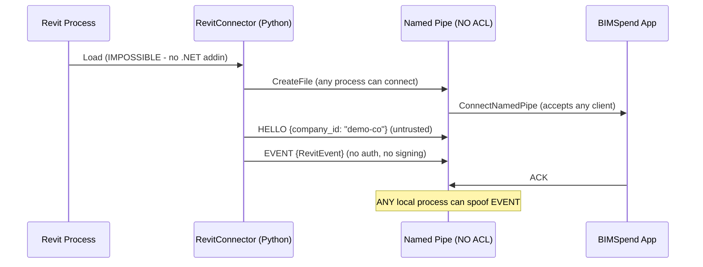
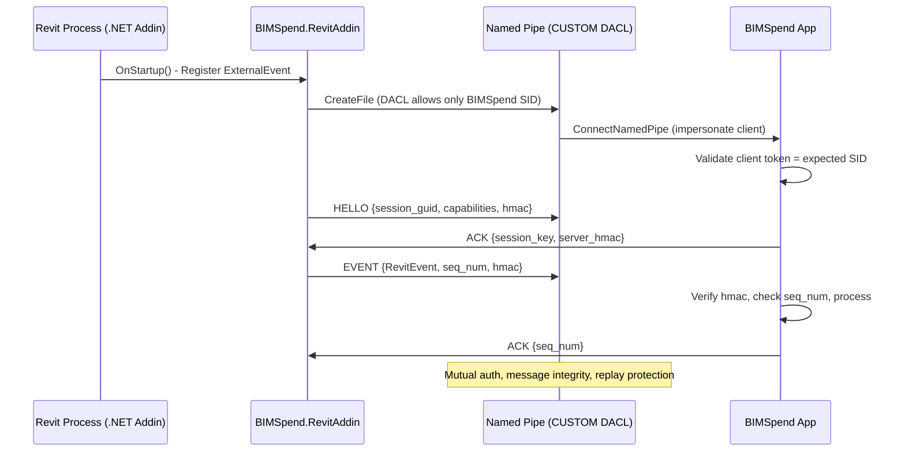

# Revit Connector & IPC Audit — BIMSpend R1-06

**Baseline**: `4e83d9b41533423f50c1f8042a2a2ef79445f0a4`
**Files Audited**:
- `src/bimspend/capture/revit_connector.py` (533 lines)
- `src/bimspend/capture/revit_ipc.py` (415 lines)

---

## Executive Summary

**The Revit integration is a Python stub, not a functioning Revit add-in.** There is no .NET assembly, no `.addin` manifest, no Revit API thread marshaling, and no deployment mechanism. The `RevitConnector` class only works when `Autodesk.Revit.DB/UI` imports succeed (which they won't in a standard Python environment), and even then runs in "stub mode" emitting synthetic events.

The IPC layer (`revit_ipc.py`) implements named pipe communication correctly but **lacks access control (ACL)**, making it vulnerable to local spoofing, injection, and DoS.

---

## Revit Connector Analysis

### Current Implementation (`revit_connector.py`)

```python
# Lines 39-62: Import guard
try:
    from Autodesk.Revit.DB import Document, DocumentChangedEventArgs, ...
    from Autodesk.Revit.UI import UIApplication
    from Autodesk.Revit.UI.Events import ViewActivatedEventHandler
    _HAS_REVIT_API = True
except (ImportError, OSError):
    _HAS_REVIT_API = False
```

### What Exists
| Component | Status | Details |
|-----------|--------|---------|
| Event subscriptions | ✅ Code complete | DocumentOpened, DocumentClosing, DocumentClosed, DocumentChanged, ViewActivated |
| Document identity | ✅ Code complete | `RevitDocumentIdentity` with GUID, title hash, path hash, workshared flag |
| Event emission | ✅ Code complete | `RevitEvent` with type, timestamp, document_identity, view_name_hash |
| Session management | ✅ Code complete | `session_guid`, `process_id`, `company_id` scoping |
| Thread safety | ✅ Code complete | `_document_lock` for active documents dict |
| Statistics | ✅ Code complete | `get_stats()` returns event count, active docs, subscribed status |
| Standalone observer | ✅ Code complete | `StandaloneRevitObserver` for testing without Revit |

### What's Missing (Critical)
| Missing Component | Impact |
|-------------------|--------|
| **.NET Assembly** | No compiled DLL — Python cannot load Revit API directly |
| **`.addin` Manifest** | No XML manifest for Revit to discover/load the add-in |
| **Revit API Thread Marshaling** | Revit API requires `ExternalEvent` + `IExternalEventHandler` on valid API context |
| **Add-in Entry Point** | No `IExternalApplication` implementation (OnStartup/OnShutdown) |
| **Deployment** | No installer, no add-in registration, no versioning |
| **Supported Revit Versions** | Not documented — no version compatibility matrix |
| **Cloud Model Identification** | `Document.UniqueId` changes on detach/cloud sync — not handled |
| **Multiple Revit Instances** | Code supports it but no IPC routing for multi-instance |
| **Read-only Guarantee** | Not enforced — no code analysis or sandbox |

### Stub Mode Behavior
When `_HAS_REVIT_API=False` (always true in CPython):
```python
def connect(self, revit_app):
    if not _HAS_REVIT_API:
        logger.warning("Revit API not available — connector runs in stub mode")
        self._started_at = datetime.now(timezone.utc).isoformat()
        self._emit_event(RevitEventType.SESSION_STARTED)
        return True  # Returns SUCCESS but does nothing real
```

### Revit API Constraints Not Addressed
| Constraint | Status |
|------------|--------|
| Revit API only callable from Revit API context (IExternalCommand, IExternalEventHandler) | ❌ Not addressed |
| Modeless UI requires `ExternalEvent.Raise()` + handler | ❌ Not implemented |
| Document events fire on Revit API thread — must marshal | ❌ Not implemented |
| `UIApplication` lifetime tied to Revit session | ❌ Not managed |
| Add-in must be signed for production | ❌ Not addressed |

---

## Revit IPC Analysis

### Named Pipe Implementation (`revit_ipc.py`)

#### Server (BIMSpend side)
```python
pipe = win32pipe.CreateNamedPipe(
    self.pipe_name,
    win32pipe.PIPE_ACCESS_DUPLEX,
    win32pipe.PIPE_TYPE_MESSAGE | win32pipe.PIPE_READMODE_MESSAGE | win32pipe.PIPE_WAIT,
    self.max_instances,  # default 4
    self.buffer_size,    # default 65536
    self.buffer_size,
    0,                   # default timeout
    None                 # SECURITY_ATTRIBUTES = NULL → DEFAULT DACL
)
```

#### Client (Revit connector side)
```python
pipe = win32file.CreateFile(
    self.pipe_name,
    win32file.GENERIC_READ | win32file.GENERIC_WRITE,
    0,  # no sharing
    None,  # SECURITY_ATTRIBUTES = NULL
    win32file.OPEN_EXISTING,
    0,
    None
)
```

### Security Vulnerabilities

| Vulnerability | Severity | Evidence |
|---------------|----------|----------|
| **No DACL on pipe creation** | CRITICAL | `CreateNamedPipe` called with `lpSecurityAttributes=None` — inherits default DACL (typically `SYSTEM`, `Administrators`, `Authenticated Users`) |
| **Any local process can connect** | CRITICAL | No client authentication beyond `company_id` in HELLO payload |
| **No message integrity verification** | HIGH | JSON messages accepted without signature/MAC |
| **No replay protection** | HIGH | No sequence numbers, timestamps not validated for freshness |
| **Queue DoS potential** | MEDIUM | `_send_queue` maxsize=100, `_receive_queue` maxsize=1000 — unbounded producer can fill |
| **No connection rate limiting** | MEDIUM | Server accepts connections in loop without backoff |
| **Fallback in-memory queue changes security model** | MEDIUM | When `win32pipe` unavailable, uses `queue.Queue` — no isolation, same process |

### Message Protocol
| Message Type | Direction | Payload |
|--------------|-----------|---------|
| HELLO | Client→Server | `{company_id, capabilities}` |
| EVENT | Client→Server | `RevitEvent.to_dict()` |
| ACK | Server→Client | `{original_id, status}` |
| ERROR | Bidirectional | `{code, message}` |
| GOODBYE | Bidirectional | `{reason}` |

### Missing Security Controls
1. **Pipe Security Descriptor** — Should use `SECURITY_ATTRIBUTES` with custom DACL allowing only:
   - `SYSTEM`
   - `Creator Owner` (the BIMSpend process)
   - Specific service account if applicable
2. **Client Authentication** — Mutual TLS equivalent: pipe impersonation + token validation
3. **Message Signing** — HMAC-SHA256 with session key derived from HELLO exchange
4. **Replay Protection** — Monotonic sequence numbers per session
5. **Rate Limiting** — Max connections/sec, max messages/sec per client

---

## Multi-Instance Support

### Current State
- `RevitConnector` accepts `process_id` and `session_guid` — supports multiple instances in theory
- `IPCChannel` uses `pipe_name` — but defaults to `\\.\pipe\bimspend_revit_` + name
- **No instance isolation** — All instances would connect to same pipe name unless unique names generated

### Required for Multi-Instance
| Requirement | Status |
|-------------|--------|
| Unique pipe name per Revit process | ❌ Not implemented |
| BIMSpend routes messages by `session_guid` | ⚠️ Partial — `session_guid` in message but no routing logic |
| Per-instance correlation state | ❌ `ProjectCorrelationEngine` is company-scoped, not session-scoped |

---

## Document Identity & Correlation Risks

### RevitDocumentIdentity (`revit_connector.py:88-121`)
```python
@dataclass
class RevitDocumentIdentity:
    document_guid: str        # Revit UniqueId — stable across saves
    title_hash: str           # Privacy-hashed title
    path_hash: Optional[str]  # Privacy-hashed path
    central_path_hash: Optional[str]  # Workshared central path
    document_type: Optional[str]      # "workshared", "standalone", "cloud"
    process_id: Optional[int]
    session_guid: Optional[str]
    is_workshared: bool
    is_unsaved: bool
```

### Correlation Risks
| Scenario | Risk | Mitigation Status |
|----------|------|-------------------|
| Two companies use same project code | Cross-tenant misattribution | ❌ `company_id` in mapping but correlation engine uses title substring |
| Document renamed | Title hash changes, GUID stable | ✅ GUID primary key |
| Model detached from central | `document_guid` changes | ❌ Not handled — treated as new document |
| Cloud model (BIM 360/ACC) | `UniqueId` may change on sync | ❌ Not tested |
| Two Revit instances open same document | Duplicate `document_guid` | ⚠️ `active_documents` dict keyed by GUID — last wins |
| Stale mapping not expired | Old mapping applies to new project | ❌ No TTL on mappings |

---

## Missing Runtime Validation

| Validation | Status | Evidence |
|------------|--------|----------|
| Revit add-in loads without error | ❌ No add-in exists |
| Event subscription succeeds | ❌ Stub mode only |
| IPC connection establishes | ❌ Never tested with real Revit |
| Event throughput under load | ❌ No load testing |
| Memory usage over 8-hour session | ❌ No profiling |
| Graceful shutdown on Revit crash | ❌ No crash handler |
| Add-in version compatibility | ❌ No version matrix |

---

## Findings

| ID | Severity | Category | Finding |
|----|----------|----------|---------|
| RC-001 | CRITICAL | Architecture | No .NET Revit add-in — Python cannot call Revit API directly; connector is non-functional stub |
| RC-002 | CRITICAL | Deployment | No `.addin` manifest — Revit cannot discover/load any add-in |
| RC-003 | CRITICAL | Security | Named pipe created with default DACL — any local process can connect/spoof events |
| RC-004 | CRITICAL | Security | No client authentication on IPC — `company_id` in HELLO is untrusted |
| RC-005 | HIGH | Architecture | Revit API thread marshaling not implemented — events fire on Revit thread, must use `ExternalEvent` |
| RC-006 | HIGH | Architecture | No `IExternalApplication` entry point — no OnStartup/OnShutdown lifecycle |
| RC-007 | HIGH | Data Integrity | Cloud model `UniqueId` instability not handled — detachment/sync changes identity |
| RC-008 | HIGH | Data Integrity | No mapping TTL — stale document→project mappings persist indefinitely |
| RC-009 | MEDIUM | Security | No message signing/replay protection on IPC |
| RC-010 | MEDIUM | Security | Queue DoS — unbounded send queue can exhaust memory |
| RC-011 | MEDIUM | Architecture | Multi-instance routing not implemented — all instances share pipe name |
| RC-012 | MEDIUM | Operations | No supported Revit version matrix documented |
| RC-013 | LOW | Operations | No add-in signing strategy for production distribution |
| RC-014 | LOW | Observability | No health monitoring (heartbeat, event rate, error rate) |
| RC-015 | LOW | Testing | No integration test harness for Revit connector |

---

## Required Implementation for Production

### Revit .NET Add-in (Separate Project)
```
BIMSpend.RevitAddin/
├── BIMSpend.RevitAddin.csproj
├── AddinManifest.addin.xml
├── ExternalApplication.cs          # IExternalApplication
├── ExternalEventHandler.cs         # IExternalEventHandler
├── DocumentEventWatcher.cs         # Subscribes to Revit events
├── IpcClient.cs                    # Named pipe client with auth
├── DocumentIdentityProvider.cs     # Extracts GUID, path, workshared info
└── Models/
    ├── RevitEvent.cs
    └── DocumentIdentity.cs
```

### Add-in Manifest (`AddinManifest.addin.xml`)
```xml
<?xml version="1.0" encoding="utf-8"?>
<RevitAddIns>
  <AddIn Type="Application">
    <Name>BIMSpend Revit Connector</Name>
    <Assembly>BIMSpend.RevitAddin.dll</Assembly>
    <AddInId>GUID-HERE</AddInId>
    <FullClassName>BIMSpend.RevitAddin.ExternalApplication</FullClassName>
    <VendorId>BIMSpend</VendorId>
    <VendorDescription>BIMSpend Project Time & Cost Intelligence</VendorDescription>
  </AddIn>
</RevitAddIns>
```

### IPC Security Hardening
```python
# Server: CreateNamedPipe with custom SECURITY_ATTRIBUTES
sa = win32security.SECURITY_ATTRIBUTES()
sa.bInheritHandle = False
# Build DACL: SYSTEM + Creator Owner + BIMSpend process SID only
sd = win32security.SECURITY_DESCRIPTOR()
dacl = win32security.ACL()
dacl.AddAccessAllowedAce(win32security.ACL_REVISION, 
                         win32file.GENERIC_READ | win32file.GENERIC_WRITE, 
                         win32security.LookupAccountName("", "SYSTEM")[0])
dacl.AddAccessAllowedAce(win32security.ACL_REVISION,
                         win32file.GENERIC_READ | win32file.GENERIC_WRITE,
                         win32security.LookupAccountName("", "Creator Owner")[0])
# Add BIMSpend process SID
sd.SetSecurityDescriptorDacl(True, dacl, False)
sa.lpSecurityDescriptor = sd

pipe = win32pipe.CreateNamedPipe(..., sa)
```

### Client Authentication
1. Server impersonates client on connect: `win32security.ImpersonateNamedPipeClient(pipe)`
2. Gets client token: `win32security.OpenThreadToken(...)`
3. Validates client is BIMSpend-signed process or expected user
4. Reverts impersonation: `win32security.RevertToSelf()`

---

## Mermaid: Revit IPC Flow (Current vs Required)

### Current (Insecure)


### Required (Secure)
