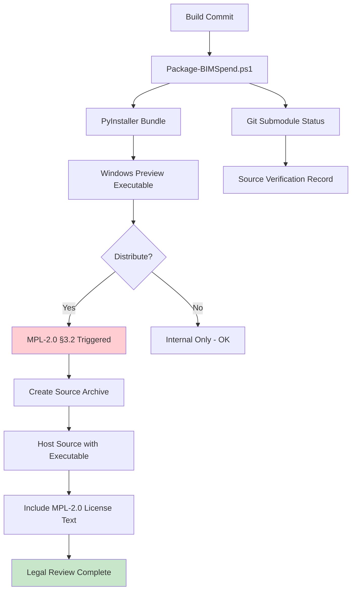

# Open Source Compliance Audit — BIMSpend R1-06

**Baseline**: `4e83d9b41533423f50c1f8042a2a2ef79445f0a4`
**Files Audited**:
- `docs/open-source/ACTIVITYWATCH_SOURCE_MANIFEST.md`
- `docs/open-source/LICENSE.MPL-2.0.activitywatch.txt`
- `src/bimspend/capture/activitywatch_derived/watcher_main.py`
- `src/bimspend/capture/activitywatch_derived/windows.py`
- `src/bimspend/capture/activitywatch_derived/privacy_filter.py`
- `src/bimspend/capture/activitywatch_derived/__init__.py`

---

## ActivityWatch Source Provenance

### Upstream Components

| Component | Repository | Commit | License | BIMSpend Location |
|-----------|------------|--------|---------|-------------------|
| aw-watcher-window/main.py | ActivityWatch/aw-watcher-window | `12000f58d16b8fc1376af42755c688b3d7157280` | MPL-2.0 | `src/bimspend/capture/activitywatch_derived/watcher_main.py` |
| aw-watcher-window/windows.py | ActivityWatch/aw-watcher-window | `12000f58d16b8fc1376af42755c688b3d7157280` | MPL-2.0 | `src/bimspend/capture/activitywatch_derived/windows.py` |
| aw-watcher-window/privacy_filter.py | ActivityWatch/aw-watcher-window | `12000f58d16b8fc1376af42755c688b3d7157280` | MPL-2.0 | `src/bimspend/capture/activitywatch_derived/privacy_filter.py` |
| ActivityWatch Bundle | ActivityWatch/activitywatch | `9fee4702fea08dbe0149cc6e28f4ef66b49f54ec` | MPL-2.0 | Reference only |

### License Headers Verification

#### watcher_main.py (lines 1-15)
```python
"""Main watcher loop adapted from ActivityWatch aw-watcher-window/main.py.

Upstream commit 12000f58d16b8fc1376af42755c688b3d7157280, MPL-2.0.
Original copyright: ActivityWatch contributors.
See docs/open-source/ACTIVITYWATCH_SOURCE_MANIFEST.md for full provenance.
"""
```
✅ MPL-2.0 header present with upstream commit and attribution

#### windows.py (lines 1-13)
```python
"""Windows foreground-window capture primitives.

Adapted from ActivityWatch aw-watcher-window/aw_watcher_window/windows.py
(upstream commit 12000f58d16b8fc1376af42755c688b3d7157280, MPL-2.0).

Original copyright: ActivityWatch contributors.
See docs/open-source/ACTIVITYWATCH_SOURCE_MANIFEST.md for full provenance.
"""
```
✅ MPL-2.0 header present

#### privacy_filter.py (lines 1-12)
```python
"""Watcher-side privacy filter for window events.

Adapted from ActivityWatch aw-watcher-window/aw_watcher_window/privacy_filter.py
(upstream commit 12000f58d16b8fc1376af42755c688b3d7157280, MPL-2.0).

Original copyright: ActivityWatch contributors.
See docs/open-source/ACTIVITYWATCH_SOURCE_MANIFEST.md for full provenance.
"""
```
✅ MPL-2.0 header present

---

## MPL-2.0 Obligations Checklist

| Obligation | MPL-2.0 Section | Status | Evidence |
|------------|-----------------|--------|----------|
| Retain license headers on covered files | §3.1 | ✅ | All 3 files have headers |
| Preserve original copyright notices | §3.1 | ✅ | "Original copyright: ActivityWatch contributors" |
| Document modifications | §3.2 | ✅ | `ACTIVITYWATCH_SOURCE_MANIFEST.md` details all changes |
| Include license text with covered source | §3.2 | ✅ | `LICENSE.MPL-2.0.activitywatch.txt` included |
| Make source available for executable distribution | §3.2 | ⚠️ | **Pending legal review before distribution** |
| No removal of license notices | §3.4 | ✅ | Headers intact |
| No sublicensing under different terms | §3.4 | ✅ | MPL-2.0 maintained |
| Patent grant preserved | §2.1 | ✅ | MPL-2.0 includes patent grant |

---

## Modifications Documentation

### watcher_main.py
| Change | MPL-2.0 Impact |
|--------|----------------|
| Removed aw-client dependency | Covered file modified — source must be available |
| Removed multiprocessing/freeze_support | Covered file modified |
| Removed macOS/Linux strategy branches | Covered file modified |
| Removed heartbeat queuing to aw-server | Covered file modified |
| Added privacy filter integration | Covered file modified |
| Added company_id scoping | Covered file modified |
| Added capture lifecycle states | Covered file modified |
| Added explicit user-consent requirement | Covered file modified |

### windows.py
| Change | MPL-2.0 Impact |
|--------|----------------|
| Added `get_current_window()` abstraction | Covered file modified |
| Added graceful error handling | Covered file modified |
| Added `process_terminated` detection | Covered file modified |
| Kept core Win32/WMI APIs | Covered file modified |

### privacy_filter.py
| Change | MPL-2.0 Impact |
|--------|----------------|
| Simplified config (list of dicts vs TOML) | Covered file modified |
| Added `hash_title()` | Covered file modified |
| Added default privacy rules | Covered file modified |

---

## Engineering Boundary

### MPL-2.0 Covered Files (activitywatch_derived/)
```
src/bimspend/capture/activitywatch_derived/
├── __init__.py           # BIMSpend - minimal exports
├── watcher_main.py       # MPL-2.0 (adapted from ActivityWatch)
├── windows.py            # MPL-2.0 (adapted from ActivityWatch)
└── privacy_filter.py     # MPL-2.0 (adapted from ActivityWatch)
```

### BIMSpend Proprietary Files (Outside Boundary)
```
src/bimspend/capture/
├── controller.py         # Proprietary - capture lifecycle, consent, DB persistence
├── afk_detector.py       # Proprietary - GetLastInputInfo AFK detection
├── session_lock.py       # Proprietary - WTSAPI32 session lock detection
├── heartbeat.py          # Proprietary - interval management, idempotency
├── revit_connector.py    # Proprietary - Revit API integration (stub)
├── revit_ipc.py          # Proprietary - named pipe IPC
├── project_correlation.py # Proprietary - document→project correlation
├── suggestion_engine.py  # Proprietary - observation→suggestion grouping
├── suggestion_domain.py  # Proprietary - suggestion lifecycle
└── __init__.py
```

### Communication Interface (Clean Boundary)
```python
# activitywatch_derived → Proprietary
get_current_window() → dict          # Raw window observation
apply_privacy_filters() → dict | None # Privacy-filtered observation
HeartbeatLoop(on_window=callback)    # Callback per accepted observation

# Proprietary → activitywatch_derived
CaptureController configures:
- poll_time
- exclude_title / exclude_titles / exclude_apps
- privacy_filter_rules
- on_window callback
```

✅ **Boundary maintained** — Proprietary code does not modify MPL-2.0 files. Communication through well-defined interfaces.

---

## Miru Evaluation

### Status
**Miru source code was NOT reused** — Only architectural inspiration.

### Evidence
- `src/bimspend/adapters/miru.py` — 1575 lines, reads synthetic JSON fixtures
- `src/bimspend/adapters/base.py` — Defines `ProjectAdapter` abstract interface
- No Miru source files in codebase
- No Miru license headers anywhere
- `ACTIVITYWATCH_SOURCE_MANIFEST.md` only documents ActivityWatch

### Conclusion
No Miru licensing obligations. The `MiruProjectAdapter` is a BIMSpend proprietary implementation of the `ProjectAdapter` interface.

---

## Third-Party Dependencies

### Runtime Dependencies (pyproject.toml)
```toml
[project]
dependencies = []  # Zero runtime dependencies!

[project.optional-dependencies]
dev = ["pytest>=8.0"]
```

### Implicit Dependencies (imported but not declared)
| Module | Source | License | Status |
|--------|--------|---------|--------|
| `win32api`, `win32gui`, `win32process`, `win32pipe`, `win32security`, `win32file`, `win32event` | pywin32 | PSF-like (Python Software Foundation) | ✅ Compatible |
| `wmi` | WMI Python wrapper | MIT | ✅ Compatible |
| `ctypes`, `hashlib`, `secrets`, `threading`, `sqlite3`, `json`, `datetime`, `enum`, `dataclasses` | Python stdlib | PSF | ✅ Compatible |

### Packaging Dependencies (scripts/Package-BIMSpend.ps1)
- `pyinstaller==6.16.0` — GPLv2 with runtime exception
- **Impact**: PyInstaller bundles Python interpreter + dependencies; GPLv2 exception allows proprietary app distribution

---

## Distribution Compliance Gap

### Current State
| Artifact | Source Availability | MPL-2.0 §3.2 Compliance |
|----------|---------------------|-------------------------|
| Source repository | ✅ Public (GitHub) | ✅ Source available |
| Windows preview executable | ❌ No source bundle | ❌ **Non-compliant if distributed** |
| PyInstaller bundle | ❌ No corresponding source | ❌ **Non-compliant if distributed** |

### Required for Executable Distribution
Per MPL-2.0 §3.2: *"If You distribute Covered Software in Executable Form... You must also make available the Source Code Form..."*

**Action Required Before Any Distribution**:
1. Create source archive matching executable build commit
2. Host source archive at same location as executable (or documented URL)
3. Include MPL-2.0 license text in distribution
4. Legal review of MPL-2.0 + PyInstaller GPLv2 interaction

---

## Findings

| ID | Severity | Category | Finding |
|----|----------|----------|---------|
| OS-001 | HIGH | Distribution | MPL-2.0 source distribution obligation not fulfilled for executable distribution (Windows preview, PyInstaller bundle) |
| OS-002 | MEDIUM | Documentation | `LICENSE.MPL-2.0.activitywatch.txt` is a placeholder — full MPL-2.0 text not included |
| OS-003 | MEDIUM | Verification | Git submodule SHA equality between bundle commit `9fee4702` and aw-watcher-window commit `12000f58` marked "NÃO VALIDADO" (not validated) |
| OS-004 | LOW | Attribution | `__init__.py` in activitywatch_derived lacks MPL-2.0 header (minimal file, but should have notice) |
| OS-005 | LOW | Dependencies | PyInstaller GPLv2 + MPL-2.0 license interaction not analyzed |

---

## Recommendations

### Before Any Distribution (P0)
1. **Include full MPL-2.0 text** in `LICENSE.MPL-2.0.activitywatch.txt` (replace placeholder)
2. **Create source distribution package** matching each executable release
3. **Host source package** alongside executable artifacts
4. **Legal review** of MPL-2.0 §3.2 compliance + PyInstaller GPLv2 exception

### Ongoing (P1)
5. **Validate git submodule SHA equality** — Record `git submodule status --recursive` at build time
6. **Add MPL-2.0 header to `activitywatch_derived/__init__.py`**
7. **Document PyInstaller license exception** in distribution README

### Process (P2)
8. **Automate source bundle creation** in `Package-BIMSpend.ps1`
9. **Add license check to CI** — Verify all MPL-2.0 files have headers
10. **Track upstream ActivityWatch updates** — Security patches, license changes

---

## Mermaid: License Boundary

```mermaid
graph TB
    subgraph MPL["MPL-2.0 Covered (activitywatch_derived)"]
        WM[watcher_main.py]
        WIN[windows.py]
        PF[privacy_filter.py]
        INIT[__init__.py]
    end
    
    subgraph PROP["BIMSpend Proprietary"]
        CTRL[controller.py]
        AFK[afk_detector.py]
        LOCK[session_lock.py]
        HB[heartbeat.py]
        REVIT[revit_connector.py]
        IPC[revit_ipc.py]
        CORR[project_correlation.py]
        SUGG_ENG[suggestion_engine.py]
        SUGG_DOM[suggestion_domain.py]
    end
    
    subgraph ADAPTERS["Adapters (Proprietary Interfaces)"]
        BASE[base.py]
        AW_AD[activitywatch.py]
        MIRU[miru.py]
    end
    
    WM -.->|get_current_window()| CTRL
    WIN -.->|get_current_window()| WM
    PF -.->|apply_privacy_filters()| CTRL
    CTRL -.->|HeartbeatLoop config| WM
    
    CTRL --> DB[(Database)]
    SUGG_ENG --> DB
    CORR --> DB
    REVIT -.->|IPC| IPC
    IPC --> DB
    
    BASE <.. AW_AD
    BASE <.. MIRU
    
    style MPL fill:#fff3e0
    style PROP fill:#e8f5e9
    style ADAPTERS fill:#e3f2fd
```

---

## Mermaid: Distribution Compliance Flow

