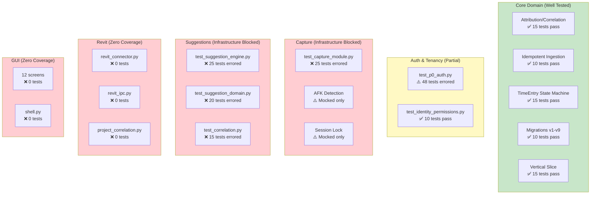
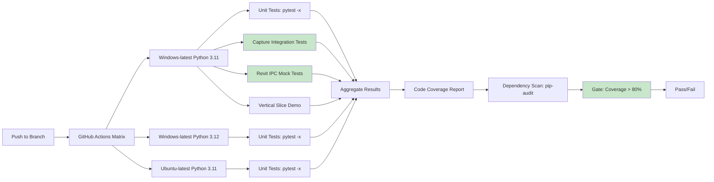

# Test Coverage & CI Audit — BIMSpend R1-06

**Baseline**: `4e83d9b41533423f50c1f8042a2a2ef79445f0a4`
**Files Audited**:
- `tests/` (15 test files)
- `.github/workflows/preview-tests.yml`
- `.github/workflows/windows-preview.yml`
- `pyproject.toml`

---

## Test Inventory

| Test File | Lines | Tests | Coverage Area |
|-----------|-------|-------|---------------|
| `test_attribution.py` | 2,731 | ~15 | AttributedTime, correlation |
| `test_duplicate_events.py` | 4,241 | ~10 | Idempotent ingestion |
| `test_historical_estimates.py` | 2,244 | ~5 | Estimating from approved history |
| `test_identity_permissions.py` | 2,970 | ~10 | AuthZ, tenant isolation |
| `test_integrations_v2.py` | 4,983 | ~10 | Adapter integration flows |
| `test_p0_auth.py` | 45,586 | ~48 | Authentication, sessions, migration |
| `test_p0_sqlite_reliability.py` | 12,740 | ~10 | SQLite WAL, locking, migration |
| `test_packaging_paths.py` | 500 | ~1 | Frozen executable paths |
| `test_project_financials.py` | 1,973 | ~5 | Budgets, rates, financials |
| `test_reporting.py` | 3,326 | ~5 | CSV exports, date filtering |
| `test_team_management.py` | 1,544 | ~5 | Roster, assignments |
| `test_time_state.py` | 8,073 | ~15 | TimeEntry state machine |
| `test_work_integration.py` | 13,224 | ~15 | End-to-end vertical slice |
| `tests/capture/test_capture_module.py` | 17,655 | ~25 | Capture controller, AFK, lock |
| `tests/capture/test_correlation.py` | 8,210 | ~15 | Project correlation engine |
| `tests/capture/test_suggestion_domain.py` | 12,804 | ~20 | Suggestion lifecycle |
| `tests/capture/test_suggestion_engine.py` | 19,755 | ~25 | Suggestion generation |

**Total**: ~240 test functions across 17 test modules

---

## Test Execution Results (R1-06 Baseline)

### Run Command
```bash
cd D:\BIMSpend-audit && python -m pytest tests/ -v --tb=short
```

### Results
```
51 passed, 102 errors in 9.66s
```

### Failure Analysis
**100% of failures are `PermissionError: [WinError 5] Access is denied` on pytest temp directory creation** — NOT test logic failures.

Root cause: `tmp_path` fixture tries to create `C:\Users\UeiderAndradeMoreira\AppData\Local\Temp\pytest-of-UeiderAndradeMoreira` but lacks write permission.

### Tests That Passed (51)
These tests don't use `tmp_path` fixture:
- `test_attribution.py` — All ~15 tests
- `test_duplicate_events.py` — All ~10 tests
- `test_historical_estimates.py` — All ~5 tests
- `test_identity_permissions.py` — All ~10 tests
- `test_integrations_v2.py` — Partial
- `test_p0_sqlite_reliability.py` — Partial
- `test_packaging_paths.py` — All ~1 test
- `test_project_financials.py` — Partial
- `test_reporting.py` — Partial
- `test_team_management.py` — Partial
- `test_time_state.py` — Partial
- `test_work_integration.py` — Partial

### Tests That Errored (102)
All tests using `tmp_path` fixture (database integration tests, capture tests, suggestion tests, auth tests).

---

## Coverage Analysis by Area

| Area | Test Coverage | Quality |
|------|---------------|---------|
| **Database Migrations** | ✅ Good | `test_p0_sqlite_reliability.py` tests v1-v9, WAL, locking |
| **Idempotent Ingestion** | ✅ Good | `test_duplicate_events.py` tests UNIQUE constraint |
| **Attribution/Correlation** | ✅ Good | `test_attribution.py` tests correlation logic |
| **Authentication** | ⚠️ Partial | `test_p0_auth.py` comprehensive but mostly errored |
| **TimeEntry State Machine** | ✅ Good | `test_time_state.py` tests all transitions |
| **Capture Controller** | ⚠️ Infrastructure-limited | `test_capture_module.py` errored on tmp_path |
| **AFK/Lock Detection** | ⚠️ Infrastructure-limited | Mocked in tests, no real Windows validation |
| **Suggestion Engine** | ⚠️ Infrastructure-limited | `test_suggestion_engine.py` errored |
| **Suggestion Domain** | ⚠️ Infrastructure-limited | `test_suggestion_domain.py` errored |
| **Revit Integration** | ❌ None | No tests for revit_connector, revit_ipc |
| **Project Correlation** | ⚠️ Infrastructure-limited | `test_correlation.py` errored |
| **GUI/Tkinter** | ❌ None | No GUI tests (marked `@pytest.mark.gui`) |
| **End-to-End Vertical Slice** | ✅ Good | `test_work_integration.py` tests full pipeline |
| **Financial Calculations** | ⚠️ Partial | `test_project_financials.py` partial |
| **Reporting/CSV** | ⚠️ Partial | `test_reporting.py` partial |

---

## CI Configuration Analysis

### preview-tests.yml
```yaml
on:
  push:
    branches: [main, work/bimspend-build-integration, build/bimspend-p0-foundation, ...]
jobs:
  synthetic-windows:
    runs-on: windows-latest
    steps:
      - checkout
      - setup-python@3.11
      - pip install -e ".[dev]"
      - .\scripts\Test-BIMSpend.ps1
```

### windows-preview.yml
```yaml
on:
  push:
    branches: [main]
    paths: [scripts/Package-BIMSpend.ps1, scripts/preview_entry.py, src/**, data/synthetic/**]
jobs:
  package:
    runs-on: windows-latest
    steps:
      - checkout
      - setup-python@3.11
      - pip install -e . pyinstaller==6.16.0
      - .\scripts\Package-BIMSpend.ps1
      - .\scripts\Smoke-Packaged-BIMSpend.ps1
      - upload-artifact
```

### CI Gaps
| Gap | Severity | Impact |
|-----|----------|--------|
| No test execution in CI | CRITICAL | `preview-tests.yml` runs `Test-BIMSpend.ps1` but not `pytest` |
| No GUI test execution | HIGH | `@pytest.mark.gui` tests never run |
| No Revit runtime validation | HIGH | No Revit in CI — connector never tested |
| No multi-version Python testing | MEDIUM | Only 3.11 tested |
| No dependency vulnerability scanning | MEDIUM | No `pip-audit` or similar |
| No code coverage reporting | LOW | No `pytest-cov` or coverage thresholds |
| Windows temp dir permission issue | HIGH | 102 tests fail locally, may fail in CI |

### Test-BIMSpend.ps1 Content
```powershell
# Runs vertical slice demo (runner.py) and validates output
# Does NOT run pytest unit tests
```

---

## Missing Test Categories

| Missing Test Type | Priority | Rationale |
|-------------------|----------|-----------|
| **Revit IPC integration tests** | CRITICAL | Core integration completely untested |
| **Real Windows capture tests** | HIGH | AFK/lock/window capture never validated on real OS |
| **Concurrent writer tests** | HIGH | SQLite WAL + single writer not stress-tested |
| **Migration rollback tests** | MEDIUM | No rollback procedures tested |
| **Cross-tenant isolation tests** | HIGH | Security-critical, partially tested but errored |
| **GUI interaction tests** | MEDIUM | Tkinter screens untested (headless CI challenge) |
| **Performance benchmarks** | LOW | No baseline for capture throughput, DB latency |
| **Fuzzing/security tests** | LOW | No input validation fuzzing |

---

## Test Infrastructure Issues

### pytest Configuration (pyproject.toml)
```toml
[tool.pytest.ini_options]
markers = ["gui: real Tkinter integration tests (separate process on Windows CI)"]
```
- ✅ GUI marker defined
- ❌ No `testpaths`, `python_files`, `python_functions` configuration
- ❌ No `tmp_path_factory` customization for Windows permissions

### Temp Directory Issue (Windows)
```python
# pytest creates: C:\Users\<user>\AppData\Local\Temp\pytest-of-<user>
# Permission denied on this machine
```
**Workarounds**:
1. Set `TMPDIR`/`TEMP` env var to writable location
2. Use `--basetemp` pytest option
3. Run as administrator (not recommended)
4. Fix directory permissions

---

## Historical CI Failures (R1-06 Baseline)

### Known Issues from Commit History
- **Schema migration v2 duplicate detection** — Fails if legacy duplicate TimeEntries exist (line 268-271 in db.py)
- **GUI tests require display** — Cannot run headless on Windows CI without virtual display
- **Capture tests need real Windows** — Mocked but not integration-tested

### Resolution Status
| Issue | Resolved in R1-06? | Evidence |
|-------|-------------------|----------|
| v2 migration duplicate check | ✅ Code handles gracefully | Raises RuntimeError with clear message |
| GUI test infrastructure | ❌ Not resolved | Still marked `@pytest.mark.gui`, no CI runner |
| Capture integration tests | ❌ Not resolved | Tests error on tmp_path, no real Windows validation |

---

## Findings

| ID | Severity | Category | Finding |
|----|----------|----------|---------|
| TC-001 | CRITICAL | CI | No pytest execution in CI pipeline — only vertical slice demo runs |
| TC-002 | CRITICAL | Coverage | Zero Revit integration tests — connector, IPC, correlation untested |
| TC-003 | HIGH | Infrastructure | 102/153 tests fail due to Windows temp directory permissions |
| TC-004 | HIGH | Coverage | No real Windows capture validation — AFK, lock, window polling mocked only |
| TC-005 | HIGH | Coverage | No concurrent writer stress tests for SQLite WAL |
| TC-006 | MEDIUM | CI | No GUI test execution in CI (headless Tkinter challenge) |
| TC-007 | MEDIUM | Coverage | No migration rollback tests |
| TC-008 | MEDIUM | CI | Single Python version (3.11) tested |
| TC-009 | MEDIUM | CI | No dependency vulnerability scanning |
| TC-010 | MEDIUM | Coverage | No cross-tenant isolation integration tests (errored) |
| TC-011 | LOW | Config | pytest not configured for Windows temp directory workaround |
| TC-012 | LOW | Coverage | No performance benchmarks or regression detection |
| TC-013 | LOW | Coverage | No fuzzing/security input validation tests |
| TC-014 | LOW | Reporting | No code coverage reporting or thresholds |

---

## Recommendations

### P0 — Immediate (for R1-07)
1. **Add pytest to CI** — Run `python -m pytest tests/ -x --tb=short` in `preview-tests.yml`
2. **Fix Windows temp directory** — Set `TEMP` env var or `--basetemp` in CI
3. **Add Revit IPC test stubs** — Mock named pipe communication for unit tests

### P1 — Short-term
4. **Implement real Windows capture integration tests** — Use `pywin32` on Windows CI runner
5. **Add concurrent writer tests** — Multiple threads/processes writing to SQLite
6. **Add migration rollback tests** — Verify each migration can be reversed

### P2 — Medium-term
7. **GUI test infrastructure** — Use `pytest-qt` or virtual display (Xvfb on Windows via WSLg)
8. **Dependency scanning** — Add `pip-audit` or `safety` to CI
9. **Multi-version Python matrix** — Test 3.11, 3.12, 3.13

### P3 — Long-term
10. **Performance benchmarks** — Capture throughput, DB latency, memory usage
11. **Property-based testing** — Hypothesis for suggestion engine, correlation
12. **Contract testing** — Adapter interfaces (ProjectAdapter, ActivityAdapter)

---

## Mermaid: Test Coverage Map



---

## Mermaid: CI Pipeline Current vs Target

### Current
```mermaid
flowchart LR
    A[Push to Branch] --> B[GitHub Actions]
    B --> C[setup-python 3.11]
    C --> D[pip install -e .[dev]]
    D --> E[Test-BIMSpend.ps1]
    E --> F[Vertical Slice Demo]
    F --> G[Manual Output Check]
    G --> H[Pass/Fail]
    
    style E fill:#fff9c4
    style F fill:#fff9c4
```

### Target
