# Remediation Roadmap — BIMSpend R1-06 Audit

**Baseline**: `4e83d9b41533423f50c1f8042a2a2ef79445f0a4`
**Audit Branch**: `audit/kilo-nemotron-r1-06-independent-review`

---

## Priority Framework

| Priority | Definition | Timeline |
|----------|------------|----------|
| **P0** | Security vulnerabilities, data integrity violations, CI foundation | Immediate (before R1-07) |
| **P1** | Core workflow reliability, authorization correctness, tenant isolation | Short-term (R1-07) |
| **P2** | Revit runtime reliability, capture quality, IPC security | Medium-term (R1-08) |
| **P3** | Maintainability, observability, configuration, performance | Long-term (R1-09+) |

---

## P0 — Security & Data Integrity (Immediate)

### CRIT-001/002: Implement Real Revit .NET Add-in
**Owner**: OpenCode (new project)
**Dependencies**: None
**Deliverables**:
- `BIMSpend.RevitAddin/` C# project targeting .NET Framework 4.8 / .NET 6+
- `ExternalApplication.cs` implementing `IExternalApplication`
- `ExternalEventHandler.cs` implementing `IExternalEventHandler`
- `DocumentEventWatcher.cs` subscribing to Revit events
- `AddinManifest.addin.xml` for Revit discovery
- CI pipeline for add-in build/test

**Acceptance Criteria**:
- Add-in loads in Revit 2022-2025 without error
- DocumentOpened/Closed/Changed/ViewActivated events emitted
- IPC client connects to BIMSpend named pipe
- Unit tests for event marshaling

### CRIT-003/004: Harden Named Pipe IPC
**Owner**: OpenCode
**Dependencies**: CRIT-001 (add-in provides client)
**Deliverables**:
- Custom `SECURITY_ATTRIBUTES` with DACL: SYSTEM + Creator Owner + BIMSpend SID only
- Client impersonation + token validation on server
- HMAC-SHA256 message signing with session keys
- Monotonic sequence numbers for replay protection
- Rate limiting: max 10 connections/sec, 100 messages/sec/client

**Acceptance Criteria**:
- Unauthorized process cannot connect (access denied)
- Spoofed messages rejected (HMAC verification)
- Replay attacks blocked (sequence validation)
- Load test: 1000 msg/sec sustained

### CRIT-005: Enforce FK on `time_entries.attributed_time_id`
**Owner**: OpenCode
**Dependencies**: None
**Deliverables**:
- Modify base DDL in `db.py:_create_tables()`:
  ```sql
  attributed_time_id TEXT NOT NULL REFERENCES attributed_time(id)
  ```
- Add migration v10 to add FK to existing databases (if v2 unique index exists)
- Test: orphaned TimeEntry insert fails

**Acceptance Criteria**:
- `INSERT INTO time_entries ...` with invalid `attributed_time_id` → FK violation
- Existing v2+ databases migrate cleanly

### CRIT-006: Gate Capture Consent at Database Layer
**Owner**: OpenCode
**Dependencies**: None
**Deliverables**:
- Add `consent_token` parameter to `Database.ingest_event()`
- `CaptureController` generates token on `grant_consent()`
- Token validated in `ingest_event()` — reject if invalid/expired
- Token stored in `capture_consents` table with expiry

**Acceptance Criteria**:
- Direct `db.ingest_event()` without token → rejected
- Valid token from `grant_consent()` → accepted
- Revoked consent → token invalidated

### CRIT-007: Add pytest to CI Pipeline
**Owner**: OpenCode
**Dependencies**: TC-003 (temp dir fix)
**Deliverables**:
- Update `.github/workflows/preview-tests.yml`:
  ```yaml
  - name: Run unit tests
    run: python -m pytest tests/ -x --tb=short
  ```
- Set `TEMP` env var in workflow:
  ```yaml
  env:
    TEMP: ${{ runner.temp }}
  ```

**Acceptance Criteria**:
- CI runs pytest on every push
- All 153 tests pass (or documented skips)
- Failed tests block merge

### CRIT-008: Add Revit IPC Test Stubs
**Owner**: OpenCode
**Dependencies**: None
**Deliverables**:
- `tests/capture/test_revit_ipc.py` with mocked named pipe
- Test HELLO/EVENT/ACK/GOODBYE message flow
- Test authentication validation
- Test queue backpressure handling

**Acceptance Criteria**:
- IPC protocol tests pass in CI without real Revit
- Message serialization/deserialization validated

---

## P1 — Core Workflow Reliability (R1-07)

### HIGH-001/002: Extract Seeding Logic from GUI
**Owner**: OpenCode
**Dependencies**: None
**Deliverables**:
- New `DataSeeder` class in `src/bimspend/seeder.py`
- `seed_projects()`, `seed_events()`, `seed_correlation()`, `seed_suggestions()`
- `shell.py` calls `DataSeeder.seed_all(db)` in `_load_data()`

**Acceptance Criteria**:
- `shell.py` reduced by ~50 lines
- Seeder unit-testable with mock DB
- No demo data in production app init

### HIGH-003/008: Per-Session AFK Detection
**Owner**: OpenCode
**Dependencies**: None
**Deliverables**:
- Modify `AFKDetector` to accept session ID
- Use `WTSQuerySessionInformation` with session ID for idle time
- Fallback to system-wide if per-session unavailable

**Acceptance Criteria**:
- Multi-user Windows: each session tracked independently
- Fast user switching: correct AFK per session

### HIGH-004/005: Integrate Session Lock into Capture
**Owner**: OpenCode
**Dependencies**: HIGH-003
**Deliverables**:
- `CaptureController` instantiates `SessionLockDetector`
- Lock callback pauses capture; unlock resumes
- `HeartbeatManager.observe()` receives `is_locked` parameter
- Locked intervals never attributed

**Acceptance Criteria**:
- Win+L → capture pauses immediately
- Unlock → capture resumes
- No attributed time during locked state

### HIGH-006/007: Project Code Registry for Correlation
**Owner**: OpenCode
**Dependencies**: None
**Deliverables**:
- `ProjectCorrelationEngine.register_project_code()` used in correlation
- UI for managers to define project codes (e.g., "P-2024-001")
- Correlation strategy: exact code match > substring match
- Confidence: EXPLICIT_CODE=0.95, SUBSTRING=0.60

**Acceptance Criteria**:
- Revit document "P-2024-001_Hospital.rvt" → Project P-2024-001 (CONFIRMED)
- No false positives on partial matches

### HIGH-009/010: Timezone-Aware Suggestion Grouping
**Owner**: OpenCode
**Dependencies**: None
**Deliverables**:
- `SuggestionConfig.timezone` parameter (default UTC)
- Day boundaries at local midnight
- AFK/lock gaps respect local day boundaries

**Acceptance Criteria**:
- User in UTC+10: suggestions grouped by local day
- No cross-midnight suggestions

### HIGH-011: Company Scoping on All DB Queries
**Owner**: OpenCode
**Dependencies**: None
**Deliverables**:
- Add `company_id` parameter to all `list_*`/`get_*` methods
- Default from `current_auth.actor.company_id`
- Raise if called without company context (except admin)

**Acceptance Criteria**:
- `db.list_projects()` → only current company's projects
- Direct DB access still possible but requires explicit company_id

### HIGH-012: Thread-Safe Auth Context
**Owner**: OpenCode
**Dependencies**: None
**Deliverables**:
- Replace module-level `current_auth` with `contextvars.ContextVar`
- Per-request `SessionContext` in web/background workers
- `require_actor()` uses context var

**Acceptance Criteria**:
- Concurrent requests don't share auth state
- Background workers can have isolated auth

---

## P2 — Revit Runtime & Integration Reliability (R1-08)

### MED-001/002/003: Capture Service Facade
**Owner**: OpenCode
**Dependencies**: P0 capture consent, P1 AFK/lock integration
**Deliverables**:
- `CaptureService` class encapsulating: `CaptureController`, `AFKDetector`, `SessionLockDetector`, `HeartbeatManager`
- Single `start()`/`stop()`/`pause()`/`resume()` API
- Health metrics: events/sec, drop rate, error rate, last poll

**Acceptance Criteria**:
- Single entry point for all capture operations
- Health endpoint for monitoring

### MED-004/005/006: Capture Quality Improvements
**Owner**: OpenCode
**Dependencies**: P2 Capture Service
**Deliverables**:
- Configurable poll interval (1-30s)
- Sub-poll detection for rapid switches (ETW research)
- Expanded privacy rules (healthcare, legal, govt patterns)
- Capture quality dashboard in UI

**Acceptance Criteria**:
- Config file for capture parameters
- Quality metrics visible in Integrations screen

### MED-008/009/010: IPC Security Hardening (Post P0)
**Owner**: OpenCode
**Dependencies**: CRIT-003/004
**Deliverables**:
- Connection rate limiting
- Message size limits (max 1MB)
- Graceful degradation on pipe errors
- Health monitoring: connection count, message rate, error rate

**Acceptance Criteria**:
- DoS attempt (1000 connections/sec) → rejected after limit
- Malformed messages → logged, connection not crashed

### MED-011/012/013: Correlation Confidence Calibration
**Owner**: OpenCode
**Dependencies**: HIGH-006/007
**Deliverables**:
- Weighted confidence: duration × method_weight
- Configurable thresholds per company
- Designer correction feedback loop → ML retraining (future)

**Acceptance Criteria**:
- Confidence correlates with designer acceptance rate
- Per-company calibration stored

### MED-014/015/016: Suggestion Engine Quality
**Owner**: OpenCode
**Dependencies**: HIGH-008/009
**Deliverables**:
- Configurable: break chain on AFK/lock (default: true)
- Duration-weighted project assignment
- Confidence = weighted average, not max
- Stable IDs: hash(user + day + project) not evidence_ids

**Acceptance Criteria**:
- AFK gaps create separate suggestions (configurable)
- Suggestion IDs stable across re-processing

### MED-018/019/020: Suggestion Domain Fixes
**Owner**: OpenCode
**Dependencies**: None
**Deliverables**:
- `return_for_correction` → new state `RETURNED_FOR_CORRECTION`
- Split/merge audit: use standard states + action metadata
- Validate `edited_minutes`/`edited_project_id` on submit

**Acceptance Criteria**:
- `WHERE state = 'RETURNED_FOR_CORRECTION'` works
- Designer cannot submit without review

### MED-021/022/023: Migration & Schema Improvements
**Owner**: OpenCode
**Dependencies**: CRIT-005
**Deliverables**:
- Document rollback SQL for each migration
- v10: FK on attributed_time_id + `evidence_ids` as separate table
- Automated migration testing in CI

**Acceptance Criteria**:
- `pytest tests/test_migrations.py` passes
- Rollback scripts tested

### MED-024/025/026: Auth & Tenancy Hardening
**Owner**: OpenCode
**Dependencies**: HIGH-011/012
**Deliverables**:
- `SessionContext` per request (contextvars)
- Row-level security views for all tables
- Evidence tables scoped by company_id

**Acceptance Criteria**:
- `SELECT * FROM company_projects_view` → only company projects
- Background workers use isolated auth context

### MED-027: MPL-2.0 Distribution Compliance
**Owner**: Legal + OpenCode
**Dependencies**: None
**Deliverables**:
- Full MPL-2.0 text in `LICENSE.MPL-2.0.activitywatch.txt`
- Source bundle script in `Package-BIMSpend.ps1`
- Legal sign-off before any distribution

**Acceptance Criteria**:
- Legal review complete
- Source bundle matches executable commit

### MED-028/TC-006/TC-007/TC-008: CI & Test Infrastructure
**Owner**: OpenCode
**Dependencies**: TC-003
**Deliverables**:
- GUI tests: `pytest-qt` or headless Tkinter via `xvfb-run` (WSLg)
- Python matrix: 3.11, 3.12, 3.13
- Dependency scan: `pip-audit` in CI
- Coverage: `pytest-cov` with 80% threshold

**Acceptance Criteria**:
- CI runs full test suite on 3 Python versions
- Coverage reported, threshold enforced
- No known vulnerabilities in dependencies

---

## P3 — Maintainability & Performance (R1-09+)

### LOW-001/002/003: Configuration & Observability
**Owner**: OpenCode
**Dependencies**: P2 Capture Service
**Deliverables**:
- `config.yaml` for all capture parameters
- Structured logging (structlog) with JSON output
- Prometheus metrics endpoint (`/metrics`)
- Health check endpoint (`/health`)

### LOW-004/005/006: Capture Polish
**Owner**: OpenCode
**Dependencies**: P2 Capture Quality
**Deliverables**:
- Max retry limit for capture errors
- Capture quality metrics in UI
- External config file support

### LOW-007/008/009: Revit Operations
**Owner**: OpenCode
**Dependencies**: CRIT-001/002
**Deliverables**:
- Supported Revit version matrix (2022-2025)
- Add-in signing with EV certificate
- Health monitoring in BIMSpend UI

### LOW-010/011: Correlation & Review Polish
**Owner**: OpenCode
**Dependencies**: MED-011/012/013, MED-018/019/020
**Deliverables**:
- Multi-candidate correlation scoring
- Configurable billed_minutes limit per project

### LOW-012/013/014: Database Polish
**Owner**: OpenCode
**Dependencies**: MED-021/022/023
**Deliverables**:
- Composite indexes for common queries
- CHECK constraints on state/billed_minutes
- Audit actor_id NOT NULL + valid session

### LOW-015: Open Source Documentation
**Owner**: Legal
**Dependencies**: MED-027
**Deliverables**:
- Full MPL-2.0 text
- PyInstaller license analysis document

---

## Dependency Graph

```mermaid
flowchart TD
    P0_CRIT001[CRIT-001: Revit Add-in] --> P0_CRIT002[CRIT-002: Manifest]
    P0_CRIT001 --> P2_MED010[MED-010: Multi-instance]
    P0_CRIT001 --> P3_LOW007[LOW-007: Version Matrix]
    P0_CRIT001 --> P3_LOW008[LOW-008: Signing]
    
    P0_CRIT003[CRIT-003: Pipe ACL] --> P0_CRIT004[CRIT-004: Client Auth]
    P0_CRIT003 --> P2_MED008[MED-008: Message Signing]
    P0_CRIT003 --> P2_MED009[MED-009: Queue DoS]
    P0_CRIT003 --> P2_MED010[MED-010: Multi-instance]
    
    P0_CRIT005[CRIT-005: FK] --> P1_HIGH010[HIGH-010: submit_suggestion]
    P0_CRIT005 --> P2_MED023[MED-023: evidence_ids table]
    
    P0_CRIT006[CRIT-006: Consent Gate] --> P1_HIGH008[HIGH-008: AFK Chain]
    P0_CRIT006 --> P2_LOW005[LOW-005: Quality Metrics]
    
    P0_CRIT007[CRIT-007: pytest CI] --> P0_CRIT008[CRIT-008: Revit Tests]
    P0_CRIT007 --> TC003[TC-003: Temp Dir Fix]
    
    TC003 --> P1_HIGH003[HIGH-003: Per-session AFK]
    TC003 --> P1_HIGH004[HIGH-004: Lock Integration]
    TC003 --> P2_TC004[TC-004: Capture Integration Tests]
    
    P1_HIGH003 --> P1_HIGH004
    P1_HIGH003 --> P2_MED003[MED-003: Capture Service]
    
    P1_HIGH006[HIGH-006: Project Codes] --> P1_HIGH007[HIGH-007: Correlation]
    P1_HIGH006 --> P2_MED011[MED-011: Confidence Calibration]
    P1_HIGH006 --> P2_MED012[MED-012: Weighted Confidence]
    
    P1_HIGH008[HIGH-008: AFK Chain] --> P1_HIGH009[HIGH-009: Timezone]
    P1_HIGH008 --> P2_MED014[MED-014: Break on AFK]
    P1_HIGH008 --> P2_MED015[MED-015: Duration-weighted]
    
    P1_HIGH011[HIGH-011: Company Scoping] --> P1_HIGH012[HIGH-012: Thread-safe Auth]
    P1_HIGH011 --> P2_MED025[MED-025: RLS Views]
    P1_HIGH011 --> P2_MED026[MED-026: Evidence Scoping]
    
    P2_MED001[MED-001: Capture Service] --> P2_MED004[MED-004: Config Poll]
    P2_MED001 --> P2_MED005[MED-005: Sub-poll]
    P2_MED001 --> P2_MED006[MED-006: Privacy Rules]
    P2_MED001 --> P3_LOW001[LOW-001: Config File]
    P2_MED001 --> P3_LOW002[LOW-002: Structured Logs]
    
    style P0_CRIT001 fill:#ffcdd2
    style P0_CRIT003 fill:#ffcdd2
    style P0_CRIT005 fill:#ffcdd2
    style P0_CRIT006 fill:#ffcdd2
    style P0_CRIT007 fill:#ffcdd2
    style P1_HIGH003 fill:#fff9c4
    style P1_HIGH006 fill:#fff9c4
    style P1_HIGH011 fill:#fff9c4
```



---

## Handoff to OpenCode (R1-07)

### Immediate Actions (Week 1)
1. ✅ CRIT-005: Add FK to base DDL — 1 hour
2. ✅ CRIT-006: Consent gate in `ingest_event()` — 2 hours
3. ✅ CRIT-007: pytest in CI + temp dir fix — 4 hours
4. ✅ HIGH-001/002: Extract `DataSeeder` — 4 hours
5. ✅ HIGH-011: Company scoping on DB queries — 8 hours

### Short-term (Weeks 2-4)
6. HIGH-003/004/005: Per-session AFK + Lock integration — 16 hours
7. HIGH-006/007: Project code registry + correlation — 16 hours
8. HIGH-008/009/010: Suggestion engine fixes — 16 hours
8. HIGH-012: Thread-safe auth context — 8 hours
9. CRIT-008: Revit IPC test stubs — 8 hours
10. MED-018/019/020: Suggestion domain fixes — 8 hours

### Medium-term (Weeks 5-8)
11. CRIT-001/002: Revit .NET add-in — 80 hours (separate project)
12. CRIT-003/004: IPC hardening — 24 hours
13. MED-001/002/003: Capture service facade — 16 hours
14. MED-021/022/023: Migration rollback + schema — 16 hours
15. MED-024/025/026: Auth/tenancy hardening — 16 hours
16. MED-027: MPL-2.0 compliance — Legal review
17. MED-028/TC-006/007/008: CI infrastructure — 16 hours

---

## Success Metrics

| Metric | Target | Measurement |
|--------|--------|-------------|
| Test pass rate | 100% | CI pipeline |
| Revit add-in loads | 2022-2025 | Manual + automated |
| IPC security | Zero unauthorized connections | Penetration test |
| Capture consent bypass | Impossible | Code review + test |
| Cross-tenant leakage | Zero via direct DB | Security test |
| Migration rollback | Documented + tested | Migration test suite |
| MPL-2.0 compliance | Legal sign-off | Legal review |
| Code coverage | >80% | pytest-cov |
| Dependency vulnerabilities | Zero critical/high | pip-audit |