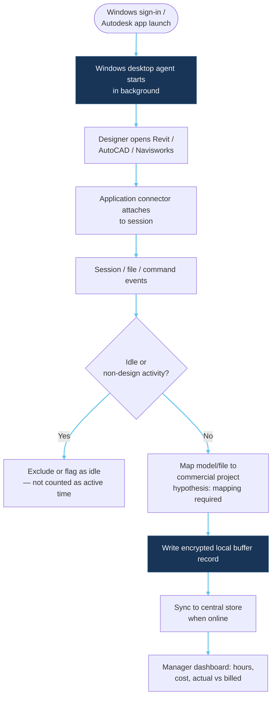
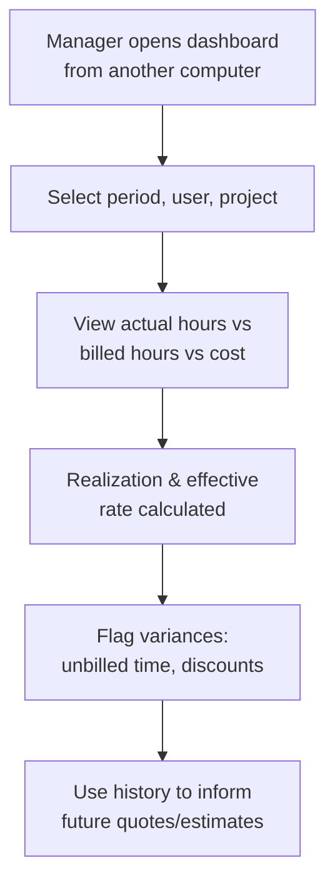

# Automatic tracking workflow — Mermaid

**Status: EXPLORATION ONLY. This is a conceptual workflow, not an implemented process.**

## Designer-side flow (zero routine interaction)

## Manager-side review flow

## Design requirements

- No designer daily login, timer, project selection, or timesheet entry (user requirement).
- Transparent monitoring with corrections/appeals process for designers.
- Admin controls deployment, user mapping, permissions, retention.
- Do not present this workflow as implemented software.
