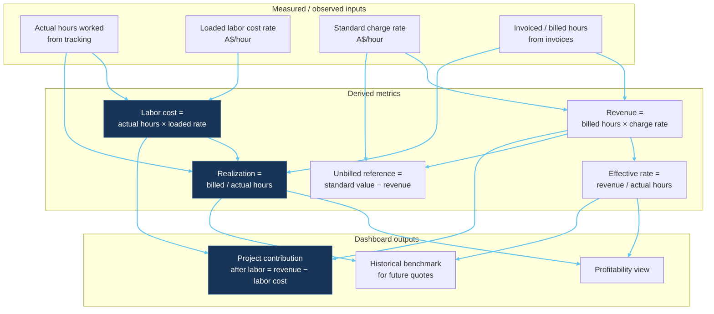

# Project time-to-cost conversion — Mermaid

**Status: EXPLORATION ONLY. Formulas are discussion aids, not an approved pricing or cost model.**

## Conversion flow

## Key distinction (synthetic illustration)

Actual hours worked ≠ hours invoiced. Example: designer works 12 hours; company invoices 8 hours at A$110/h → invoice A$880 vs standard value A$1,320. The A$440 difference is unbilled reference value, not automatically accounting loss.

## Synthetic example — project cost

| Item | Value | Basis |
|---|---|---|
| Fee | A$18,000 | Synthetic |
| Actual hours | 160 h | Synthetic |
| Loaded hourly cost | A$65/h | Synthetic |
| Labor cost | A$10,400 | Synthetic |
| Remaining after labor | A$7,600 | Excludes all other costs |

See `docs/financial-model/synthetic-examples.md` for full worked examples (Examples A–C).
