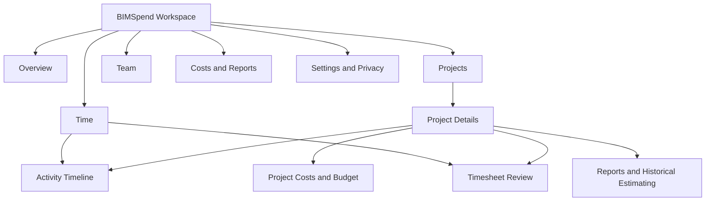
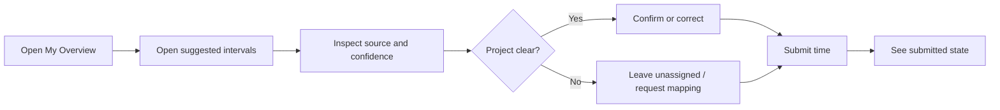
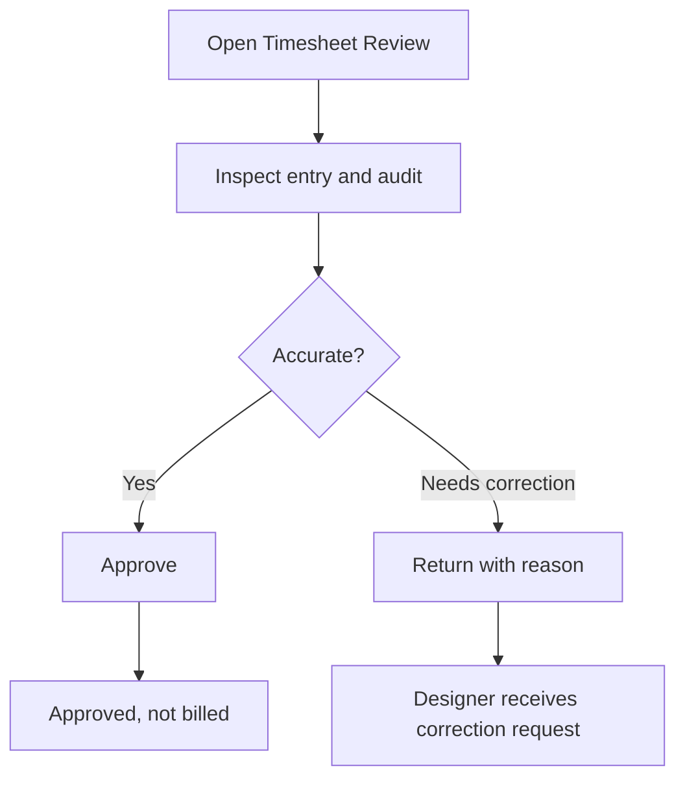

# BIMSpend — Product Information Architecture & UI Specification

**Status:** Conceptual design for implementation planning; not a claim of implemented or approved functionality.  
**Date:** 2026-11-05  
**Branch:** `work/bimspend-product-ui-design`  
**Visual companion:** [Conceptual low-fidelity wireframes](BIMSPEND_UI_WIREFRAMES.svg)

## 1. Source basis and design boundary

This specification reconciles:
- `main` planning baseline at `eb13fc90eb768080f6790bb364b482274860688c`;
- product discovery and pricing hypotheses in `docs/product-vision/*`, `docs/financial-model/commercial-data-and-pricing.md`, and `docs/decisions/decision-log.md`;
- owner-proposed Desktop Agent/Revit Companion experience on `agent/brainstorm-hybrid-product-vision`, commit `7f1f34e35be2a405b07c8e086c5a5c87bc9eb044` (brainstorm, not approved);
- Work coordination status on `work/development-coordination`, commit `c1ee01657d5b4e163706d4a28efe3e26ef9740cc`;
- technical feasibility and PLAN audit, including the Miru/ActivityWatch/Revit boundaries and validation caveats.

This is a product/UI specification, not an implementation, API contract, legal/privacy approval, or claim of feature availability. OpenCode owns the foundation implementation; Claude/FCC owns integration contracts. Work defines UI requirements and handoff criteria without implementing their assignments. The independent B2-A audit remains deferred.

**Current branch snapshot:** `build/opencode-bimspend-foundation` was not present in remote branch listing at the time checked. `build/claude-integration-contracts` exists at the same SHA as `main` and contains no changes. These designs therefore do not presume their implementation choices or contract schemas.

## 2. Product experience principles

1. **Help the designer first:** make detected time reviewable and useful; do not present capture as a performance score.
2. **Make evidence and uncertainty visible:** every suggested project/time item explains its source and confidence.
3. **Keep time states separate:** observed → suggested/attributed → user-confirmed/submitted → manager-approved → billed. Each transition has its own actor, timestamp and audit record.
4. **Keep financial measures separate:** internal loaded labor cost, client billing rate, contract fee, revenue and billed hours are distinct values.
5. **Safe defaults:** no employee monitoring, raw event collection, upload, or automatic approval is enabled by these designs. Local synthetic fixture mode is the first UI vertical slice.
6. **Role-based least privilege:** designers see their own time and permitted projects; managers see approved project/portfolio data; loaded cost, billing and margins require explicit finance permission.
7. **Explain missing data:** distinguish zero from unavailable, unconfigured, stale, unapproved, or insufficient history.
8. **Avoid false precision:** forecasts show assumptions, sample size and uncertainty; never derive “productivity” from foreground time.

## 3. Application information architecture

### 3.1 Manager / owner navigation

- **Overview**
- **Projects**
  - Project list
  - Project details
    - Summary
    - Activity timeline
    - Timesheets
    - Costs & budget
    - Reports / estimate history
- **Time**
  - Activity timeline (organization scope, if authorized)
  - Timesheet review
- **Team**
- **Reports**
  - Portfolio reports
  - Historical estimating
- **Settings**
  - Workspace and roles
  - Privacy and capture policy
  - Data retention/export
  - Integrations/devices (later, guarded)

### 3.2 Designer navigation

- **My Overview**
- **My Projects**
  - Project details (permitted summary)
- **My Activity**
  - Activity timeline and unassigned items
- **My Timesheets**
  - Drafts, submitted, returned for correction, approved
- **Privacy & Status**
  - Capture state, local queue/sync state, pause/control explanations

Designer navigation must not expose other employees' detailed activity, loaded costs, company margins, or billing rates. Any personal-time exclusion or capture setting is governed by approved company policy and applicable law; UI availability does not imply legal approval.

### 3.3 IA map

Role permissions filter the navigation and row-level data. Hiding a nav item is not authorization; backend/API permissions remain authoritative.

## 4. Shared shell, components and design tokens

### 4.1 Desktop shell

- Left rail: workspace logo/name, role-aware primary navigation, collapse control, bottom Settings and help.
- Top bar: current workspace, breadcrumbs/page title, global date range where relevant, notifications, user menu.
- Main content: max-width content canvas with page header, primary action, filters and responsive content grid.
- Persistent status region (where monitoring exists): clear capture state and sync state as separate indicators; local demo mode must state “Synthetic data”.
- Avoid global “tracking active” banners in the manager workspace; status belongs to the individual desktop agent and approved privacy context.

### 4.2 Reusable components

- Metric card with label, value, period, source/state annotation and optional trend.
- Status badge: Observed, Suggested, Unassigned, User confirmed, Submitted, Returned, Approved, Billed.
- Confidence chip: High / Medium / Low with “why” details; do not use color alone.
- Activity interval row/card with time range, source icon, project mapping, confidence, duration and correction action.
- Approval queue row with actor, project, duration, provenance and review controls.
- Budget progress visualization with approved-hours basis and explicit denominator.
- Empty/loading/error/offline/permission panels.
- Filter bar, data table with responsive card alternative, audit-history drawer, confirmation modal.
- Privacy notice panel, local synthetic-mode banner, disabled-feature explanation.

### 4.3 Provisional design tokens

Tokens are functional starting points, not approved brand identity.

| Token | Value / rule | Use |
|---|---|---|
| `color.ink` | `#172B3A` | Main text |
| `color.navy` | `#14324A` | Navigation / structural emphasis |
| `color.primary` | `#1976A5` | Links and primary action |
| `color.teal` | `#287E72` | Positive/confirmed state, paired with text |
| `color.amber` | `#A96512` | Review / attention state |
| `color.red` | `#B23B3B` | Error/rejection only |
| `color.canvas` | `#F4F7F9` | Application background |
| `color.surface` | `#FFFFFF` | Cards and panels |
| `color.border` | `#D9E1E7` | Dividers and outlines |
| `space` | 4 px base; 8/12/16/24/32 scale | Layout rhythm |
| `radius` | 6 px controls; 10 px cards | Shape |
| `type` | System UI sans; 14 px body, 12 px metadata, 20–28 px page titles | Readable dense business UI |
| `focus` | 2 px visible outline with 2 px offset | Keyboard accessibility |

Meet WCAG AA contrast for text and controls; state must never be indicated by color alone.

## 5. Screen specifications

### 5.1 Overview Dashboard

**Purpose:** orient the current user to action and project health without presenting unsupported precision.

**Manager layout:** page header/date range → four metric cards → budget/effort trend → projects needing attention → timesheet review queue → recent decisions.  
**Designer layout:** “My day” → observed / suggested / submitted / approved time groups → items to review → assigned projects → local status/privacy panel.

**Data needs:** period, workspace, role; approved and pending time totals by state; project budgets and approved actuals; cost/fee values only for authorized managers; update timestamp; data completeness; independent deliverable progress only if supported by verified source.

**Actions:** open project, open review queue, review own suggested items, change date range.

**Acceptance:** clearly state denominator and time state for every metric; no placeholder numbers except labeled synthetic demo data; missing deliverable progress must not yield an inferred risk score; designer receives no finance-only card.

### 5.2 Projects

**Purpose:** find and monitor authorized projects.

**Layout:** page header + create/import action (permission-gated) → search/filter row → table/cards with project, code, client (if authorized), phase, manager, status, approved hours vs budget, pending review count, last updated.

**Data needs:** canonical project ID/name/code, client/org scope, members/manager, phase/status, budget values and approved time aggregates, permission flags, freshness.

**Actions:** search, filter status/phase/manager, sort, open project. No automatic project assignment from filename.

**Acceptance:** project list is tenant-scoped server-side; unassigned/ambiguous local signal never creates a project mapping implicitly; financial columns are permission-gated.

### 5.3 Project Details

**Purpose:** a trustworthy project workspace that joins scope, time and financial context.

**Layout:** project header/status → Summary / Activity / Timesheets / Costs & Budget / Reports tabs → summary cards → budget-versus-approved-hours chart → team and recent changes → explicit data freshness.

**Data needs:** project identity/scope, assigned members, status, approved budget hours, contract fee (if authorized), approved/pending time states, internal cost and billing basis with currency/effective date (manager finance only), change/variation records, data quality flags.

**Actions:** edit allowed metadata, add member, navigate to timeline or review, export only if authorized.

**Acceptance:** keep budgeted, observed, attributed, user-confirmed, approved, billed and cost totals separate; each financial metric discloses source and period; no “profit” label for revenue minus labor alone.

### 5.4 Activity Timeline

**Purpose:** help a designer understand, correct and explain time suggestions; provide authorized managers an aggregated, privacy-minimized view only where policy permits.

**Layout:** date selector → daily total by state → timeline lanes (Observed signals, Suggested project attribution, User-confirmed/submitted) → unassigned items → selected interval detail with evidence/provenance and edit/reclassify/mark non-work actions. Manager mode defaults to aggregates, not raw window titles.

**Data needs:** event/interval ID, source class, start/end with timezone, active/AFK flag where available, project candidate, confidence and explanation, privacy-redacted provenance, corrections and actor/audit history.

**Actions:** accept suggestion, change project, adjust duration with reason, split/merge interval if supported, mark non-work/personal according to policy, submit selected time.

**Acceptance:** observed event is never itself approved or billed; confidence explanation is inspectable; raw title/path hidden by default; ambiguous items remain unassigned; edits preserve original evidence and create an audit trail.

### 5.5 Timesheet Review

**Purpose:** let a manager review submitted entries and return or approve with accountability.

**Layout:** review queue tabs (Needs review / Returned / Approved) → filters → table with employee, project, date, duration, description, source/provenance and state → selected entry detail and audit trail → approve / return for correction controls.

**Data needs:** entry ID, employee/project scope, date/time zone, duration, narrative, origin (manual or agent), state, edits, evidence reference (minimized), reviewer identity/time, policy and permissions.

**Actions:** inspect, approve, return with reason, open employee/project history. Bulk approval is excluded from initial MVP until per-entry review controls and audit behavior are proven.

**Acceptance:** only submitted items appear in manager queue; approval is explicit and attributable; approve/return actions enforce server-side permission and reason policy; approval does not mark billed or create invoice.

### 5.6 Team Management

**Purpose:** manage workspace membership, project assignment and role access.

**Layout:** members table → invite/add member → role and status filters → selected member panel with project assignments and permission summary. Device enrollment/monitoring controls are a later, policy-gated area.

**Data needs:** member ID/name/email, organization status, role, project memberships, invite state, auth status. Do not include salary/cost in this screen unless separately authorized; never show detailed activity here.

**Actions:** invite, deactivate, change role, assign projects, review access log.

**Acceptance:** role changes are audited; workspace boundary is enforced; removal/revocation behavior is clear; no capture enrollment or surveillance switch is enabled by default.

### 5.7 Project Costs and Budgets

**Purpose:** compare approved effort and explicitly defined costs with the approved project budget/fee.

**Layout:** metric row (budgeted hours, approved actual hours, remaining hours, internal labor cost, contract fee/revenue where permissioned) → time/cost trend → cost by phase/team → assumptions and data freshness → adjustment history.

**Data needs:** approved time only for actual labor calculations (candidate time shown separately); loaded internal cost rate with effective date/currency; standard client billing rate; contract fee and invoice values; approved budget; tax basis; authorized access.

**Actions:** edit budget/rate only by role; export; view contributing approved records.

**Acceptance:** no cost derived from billing rate unless separately configured as an explicitly labeled proxy; internal cost and client rate never share an unlabeled field; calculation states whether GST/tax included; labor contribution is not called net profit.

### 5.8 Reports and Historical Estimating

**Purpose:** compare approved historical effort and support human-led estimating, without claiming predictive validity before enough comparable data exists.

**Layout:** report selector → filters for project type/scope/levels/area/systems/phase/complexity → comparable projects → hours/cost distribution → sample size/coverage/uncertainty → assumptions and export.

**Data needs:** completed projects, approved/classified time, scope descriptors, complexity factors, cost-rate snapshots, billing/contract values separated, correction history, sample-size threshold and provenance.

**Actions:** save filter, compare cases, draft estimate, export. Future estimate remains a draft for human review.

**Acceptance:** hide or label estimates “insufficient evidence” below the approved minimum sample; show contributing cases and exclusions; no synthetic example presented as company data; estimate never silently becomes quote/contract.

### 5.9 Settings and Privacy Controls

**Purpose:** make workspace security, data collection, retention and user understanding inspectable.

**Layout:** sections: Workspace / Roles / Privacy policy / Data & retention / Integrations / Audit. User view includes personal capture state, pause/notice and own-data request options; admin view controls organization policy.

**Data needs:** effective policy version, permitted event categories, purpose, notice/acknowledgement, retention duration, pause rules, access policy, export/deletion status, integration health, change audit.

**Actions:** review policy, configure approved categories/retention, export/delete request, rotate/revoke credentials where supported. Capture controls remain off in the design/dev slice.

**Acceptance:** no capture starts because a settings screen exists; policy changes are versioned and auditable; user can understand what is collected, why, who can see it, retention and how to correct data; legal basis is a prerequisite to any employee pilot.

## 6. Cross-cutting UI states

| State | Required presentation | Required behavior |
|---|---|---|
| Empty workspace | Explain what will appear and safe setup next step | No fabricated sample data unless demo mode explicitly labeled |
| No projects assigned | Explain access/mapping; link to request access | Do not auto-map from local filenames |
| No activity | Say “No events available” with date/source status | Do not display zero productive hours |
| Loading | Skeletons matching final layout and accessible busy state | Preserve current filters/navigation |
| Partial/stale | “Updated at” + missing-source explanation | Avoid merging stale values without labeling |
| Offline/queued | Separate “offline” and “pending sync” states | Do not imply successful synchronization |
| Error | Human-readable message, error reference, retry where safe | No silent discard; no sensitive payload in logs |
| Permission denied | Explain needed role or scope | Do not leak hidden records in counts |
| Ambiguous attribution | “Needs your review” with confidence/evidence | No default auto-approval |
| Synthetic demo | Persistent “Synthetic data” badge/banner | Prevent confusing fixtures with real company data |

## 7. Responsive behavior

- **Wide desktop (≥1200 px):** persistent left rail, 12-column content grid, tables, side detail drawer.
- **Tablet (768–1199 px):** collapsed rail, two-column cards, horizontally scrollable/column-prioritized tables, detail drawer becomes full-width panel.
- **Mobile (<768 px):** bottom navigation for Overview / Projects / My Time / More; cards replace tables; filters in sheet; detail panels become full screen; sticky primary action; no dense multi-series charts.
- Preserve keyboard navigation, visible focus, screen-reader labels and reduced-motion preference at all widths.
- Do not make desktop UI the only path for correcting personal time; mobile correction is desirable later, but MVP may be responsive web only.

## 8. Core user journeys

### Designer daily review

Acceptance: user can correct an estimate and supply work description; suggested time remains distinct from submitted and approved time.

### Manager approval

Acceptance: approval requires authorized reviewer, creates audit evidence, and has no invoice side effect.

### Owner project oversight

Overview → select project → inspect approved hours vs budget → inspect cost/rate assumptions → review exceptions → export or record decision. Any forecast presents comparable sample size, uncertainty and manual override.

## 9. MVP versus later phases

| Priority | Experience | MVP slice / later |
|---|---|---|
| P0 — first executable UI slice | Synthetic event feed → local attribution review item; Overview-lite and Activity Timeline | Local fixture mode only; no watchers, employee capture, cloud sync or approval |
| P1 — foundation MVP | Projects list/details, own timesheet review/correction, explicit manager review workflow | Depends on OpenCode foundation and Claude contracts; backend permission model must be verified |
| P2 — business controls | Team/roles, project budgets, internal loaded cost, billing/fee separation | Requires finance semantics, role/security and audit decisions |
| P3 — analytical product | Portfolio reports, historical comparisons, estimate drafts with confidence | Requires clean approved history, comparable project taxonomy and validation |
| Guarded / later | Automatic capture, device enrollment, offline encrypted queue, real cloud sync | Requires B2-A technical evidence, privacy/legal policy, security review, explicit release approval |
| Out of first MVP | AI productivity scoring, automatic invoice creation, hidden monitoring, element-level Revit telemetry, broad Autodesk support | Not supported by current evidence or this design |

This priority table is a recommended sequence, not a scope approval beyond the owner's existing development authorization for the first bounded work.

## 10. Integration handoff to OpenCode

OpenCode can use this specification for navigation, screen hierarchy, component states and design acceptance. Keep the implementation aligned with Claude's forthcoming integration contracts rather than inventing parallel API schemas.

Before implementing a screen:
1. Identify the role and source-of-truth for each displayed field.
2. Bind each metric to its time state and period; mark unsupported data as unavailable.
3. Verify field names/types/state transitions against Claude's published contract when available.
4. Keep fixture mode deterministic, synthetic and network-isolated.
5. Preserve local capture off by default; avoid real employee sessions.
6. Implement page behavior and accessibility states alongside the visual layout.
7. Add tests for permissions, state labels, empty/loading/error/offline, privacy redaction and time-state separation.
8. Document any gap as blocked or proposed; don't substitute guessed values.

**Do not implement all nine screens as fully functional now.** Start with the local synthetic event-to-review path and shell; layer later screens onto verified business APIs and approved policies.

## 11. Screen inventory quick reference

| Screen | Primary role | MVP priority | Main data | Main action |
|---|---|---:|---|---|
| Overview Dashboard | Designer + Manager | P0-lite / P1 | Role-specific time states, project health | Open work/review |
| Projects | Both | P1 | Authorized projects, approved hours/budget | Open project |
| Project Details | Both, scoped | P1/P2 | Project/team/time/financial summary | Navigate to detail |
| Activity Timeline | Designer; manager aggregate | P0 | Observed/suggested/confirmed intervals | Correct/confirm |
| Timesheet Review | Manager | P1 | Submitted records and audit | Approve/return |
| Team Management | Admin/Manager | P2 | Members, roles, assignments | Manage access |
| Project Costs and Budgets | Finance-authorized manager | P2 | Budgets, approved hours, cost/fee | Review budget |
| Reports and Historical Estimating | Owner/Manager | P3 | Comparable approved history | Draft estimate |
| Settings and Privacy Controls | User + Admin | P0 safe mode / P2 policy | Policy, capture, retention, integrations | Inspect/control |

## 12. Decision boundary

The wireframes and screen requirements are conceptual. They do not make the brainstormed dashboard, monitoring model, pricing, hosting, mobile support, or historical estimate functionality approved or implemented. Development authorization does not authorize employee monitoring, deployment, production use, or a claim that B2-A passed.
