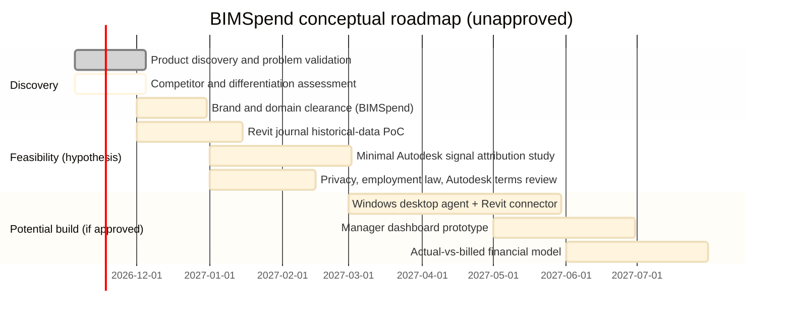

# Conceptual product roadmap — BIMSpend

**Status: EXPLORATION ONLY. These are hypotheses and possible sequences, not commitments. Nothing here is approved.**

## Roadmap states used in this project

IDEA → UNDER INVESTIGATION → VALIDATED → REJECTED / DEFERRED → APPROVED (only with explicit user approval).

## Conceptual phases (Mermaid)

## Decision gates (examples)

| Gate | Question | Required before proceeding |
|---|---|---|
| G1 | Is there a validated gap in actual-vs-billed tracking? | Buyer interviews / problem validation |
| G2 | Can Autodesk signals attribute time to a project with acceptable error? | Feasibility PoC results |
| G3 | Is monitoring permitted under law/contracts/terms? | Legal review |
| G4 | Is the brand (BIMSpend / domain) clearable? | Trademark/domain clearance |
| G5 | Should an MVP be built? | Explicit user approval |

## Next recommended step

Answer decision-log question 1: "How is actual time measured today when billed hours are discounted? What source is reliable?" This sits under G1 and precedes any build decision.
