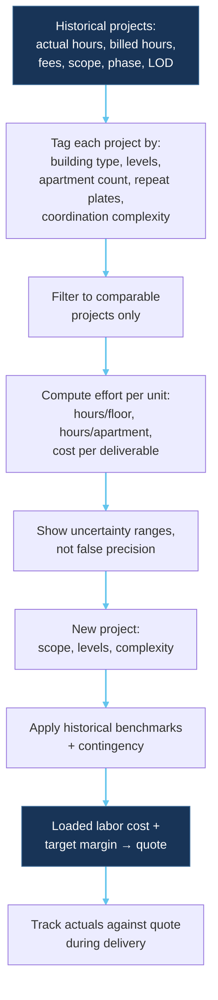

# Historical project pricing workflow — Mermaid

**Status: EXPLORATION ONLY. Historical estimating benchmarks are a hypothesis, not a validated method.**

## From history to future estimate

## Cautionary notes

- Models with equal sprinkler counts (or other deliverable counts) can require different time.
- Effort depends on project phase, model maturity, coordination complexity, scope, and variations.
- Small or non-comparable samples produce unreliable benchmarks.
- Journal-based historical recovery is unproven; see `docs/research/historical-data-research.md`.
