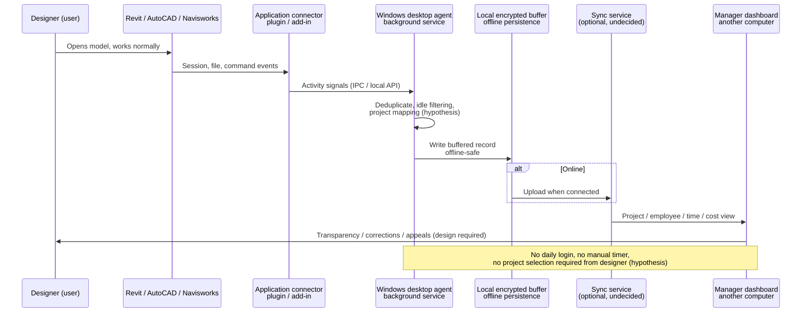

# Desktop agent and application connector communication — Mermaid

**Status: EXPLORATION ONLY. Communication protocol and boundaries are undecided.**

## Conceptual communication flow

## Open interface questions

- Connector-to-agent transport: local TCP, named pipes, .NET interop, or file-based queue — undecided.
- Version support: one build per supported Revit version; registration mechanism for later-installed versions — undecided.
- Offline behavior: local buffer with retry/sync when online — hypothesis.
- Multi-instance and multi-model deduplication — not solved.
- Security: local encryption, access controls, employee notice — design required.
