# System architecture hypothesis — Mermaid

**Status: EXPLORATION ONLY. This is a conceptual diagram, not an approved or implemented architecture.**

## Proposed component architecture

```mermaid
flowchart LR
    subgraph DesignerPC ["Designer workstation (Windows)"]
        direction TB
        A[Revit / AutoCAD / Navisworks / Civil 3D]
        B[Application-specific connector<br/>plugin or add-in]
        C[Windows desktop agent<br/>background service]
        D[Local encrypted buffer<br/>offline persistence]
    end

    subgraph Sync ["Synchronisation (optional, undecided)"]
        E[Local → cloud sync<br/>architecture undecided]
        F[Central store<br/>project + employee data]
    end

    subgraph Manager ["Manager access (another computer)"]
        G[Management dashboard<br/>web or desktop client]
        H[Reports: hours, cost,<br/>actual vs billed, estimates]
    end

    A -->|session & file events| B
    B -->|activity signals| C
    C -->|buffered records| D
    D -->|sync when online| E
    E --> F
    F --> G
    G --> H

    style A fill:#183457,stroke:#3a6995,color:#fff
    style C fill:#183457,stroke:#3a6995,color:#fff
    style D fill:#183457,stroke:#3a6995,color:#fff
    style G fill:#183457,stroke:#3a6995,color:#fff

    linkStyle default stroke:#63c5ed,stroke-width:2
```

## Related visual

- `visuals/architecture/architecture.svg` — editable SVG reconstruction of the same concept.

## Critical accounting cases (open)

Multiple Revit instances; same project in multiple models; model renamed/moved; central/local/cloud models; family editor (`.rfa`); idle periods; remote desktop; offline usage; overnight open session; simultaneous other-app use; work outside Autodesk; multi-user shared PCs; daylight saving/time zone.

## Integration hypothesis

One Windows installer bundles the desktop agent and suitable integration packages; starts at Windows sign-in and attaches to supported Autodesk products. Different Revit versions may require version-specific .NET/add-in builds; later-installed Revit versions need a supported integration registration mechanism.
